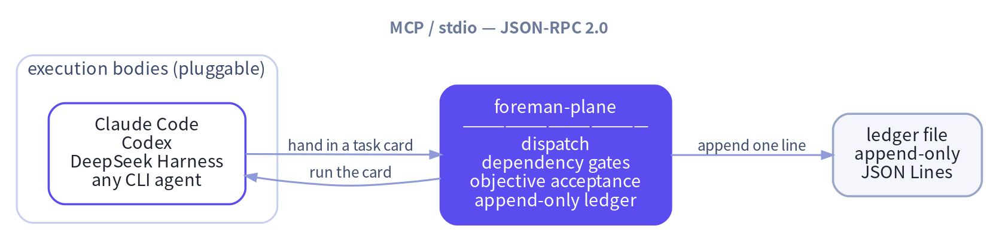
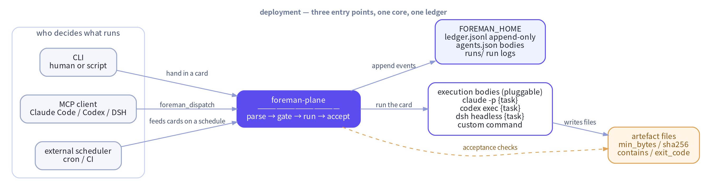
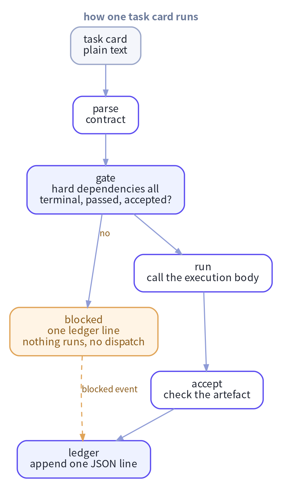

<div align="center">

# foreman-plane

### The task governance plane that runs outside your agent harness

[](https://pypi.org/project/foreman-plane/)
[](https://pypi.org/project/foreman-plane/)


**English** · [简体中文](README_ZH.md)

</div>

## One sentence

**foreman-plane is a governance plane that runs outside the agent harness.**
DeepSeek Harness, Claude Code, Codex and any CLI agent are interchangeable
execution bodies. What the plane owns is the part a session cannot own:
dispatch, dependency gating, objective acceptance and an append-only ledger.

> A promise the agent forgot is not a promise. The verdict is derived from files
> on disk, so it outlives the session that produced it.



```text
┌──────────────────┐        ┌──────────────────────┐
│ execution bodies │        │ foreman-plane        │
│ Claude Code      │ ─────▶ │ dispatch             │
│ Codex            │        │ dependency gates     │
│ DeepSeek Harness │ ◀───── │ objective acceptance │
│ any CLI agent    │        │ append-only ledger   │
└──────────────────┘        └──────────────────────┘
  MCP / stdio — JSON-RPC 2.0, one JSON object per line
```

* **Cross session** — the ledger outlives every conversation.
* **Cross instance** — several agents share one task graph.
* **Cross day** — a task dispatched today can be resumed tomorrow by any body.
* **Zero intrusion** — the plane is a plain process, no agent framework has to be patched.

Zero third-party dependencies. Python ≥ 3.10, standard library only.

## Why foreman-plane?

| Capability | What it changes |
| --- | --- |
| **Two-level dependency gate** | A card with `[depends_on]` cannot start until every upstream is terminal, passed and accepted. `[needs_api]` is the soft level: a missing artefact is reported, the task still runs. |
| **Objective acceptance** | Pass and fail are computed from the artefact — `min_bytes`, `sha256`, `contains`, `exit_code`. A task that promises a report but writes no file fails. |
| **No ghost dispatch** | A card stopped by the gate writes a `blocked` event and no `dispatch` event, so the ledger can never show a task that never ran. |
| **Append-only ledger** | One JSON line per decision. History is never rewritten or deleted, and it can be queried, diffed and audited by something that is not an LLM. |
| **Pluggable execution bodies** | The plane picks no model and does not care which command runs a card. Swap the command, keep the governance. |
| **Unparsed dependencies are fatal** | A dependency marker that cannot be parsed refuses the dispatch. It is never silently dropped. |

## What it feels like

> You: `Finish these reports first, then let the downstream job merge them.`
>
> foreman-plane: Three cards. The downstream one carries `[depends_on]`, so it
> cannot even start while the upstream files are missing. When everything is
> done the artefacts get checked again, a missing field means `fail`, and the
> ledger records which file fell short.

## Install

```bash
pip install foreman-plane
```

Or run it straight from a checkout:

```bash
cd foreman-plane
export PYTHONPATH="$PWD/src"
export FOREMAN_HOME="$PWD/.foreman"
```

Ready to run it? **[Deployment](#deployment)** below is the step-by-step:
where the plane keeps its state, which command executes a card, the first
card you hand in, and how to wire it into your harness.

## Deployment

foreman-plane is a plain process, not a service. There is no daemon, no port,
no database and no scheduler. "Deploying" it is three decisions, not a
deployment guide:

| Decision | Where | Default |
| --- | --- | --- |
| Where the plane keeps its state | `FOREMAN_HOME` | `$HOME/.foreman` |
| Which command executes a card | `${FOREMAN_HOME}/agents.json` | the built-in `generic` — empty, so it fails until you define it |
| Who may hand in cards | the caller: a person, a script or an MCP client | — |



### Step 0 — check the install

```bash
pip install foreman-plane
foreman --help
foreman config
```

`foreman config` prints the effective home, the ledger path, the run directory
and the known execution bodies. Nothing is written yet.

### Step 1 — give the plane a home

```bash
export FOREMAN_HOME=/var/lib/foreman
foreman config
```

Everything the plane owns lives under `FOREMAN_HOME`:

| Path | Written by | Purpose |
| --- | --- | --- |
| `ledger.jsonl` | the plane | the append-only audit ledger — the source of truth |
| `runs/` | the plane | one log file per run: stdout, stderr, exit code |
| `agents.json` | **you** | the execution bodies |

`FOREMAN_HOME` resolves as: the environment variable → `$HOME/.foreman` →
`<cwd>/.foreman`. It works even when `HOME` is not set. The home and `runs/`
are created automatically; `agents.json` is only read, never written for you.

### Step 2 — pick an execution body

```bash
cat > /var/lib/foreman/agents.json <<'JSON'
{
  "agents": {
    "dsh":    {"command": "dsh headless {task}"},
    "claude": {"command": "claude -p {task}"},
    "codex":  {"command": "codex exec {task}"},
    "mybot":  {"command": "mybot run --prompt {task}"}
  }
}
JSON
```

Two placeholders are available: `{task}` — replaced with the whole task card —
and `{workdir}` — replaced with the working directory. **A template without
`{task}` is refused**: the plane will not guess what the agent should be
told, so the run ends with `exit_code: 127` before anything starts.

The command is executed as a subprocess — no shell, so there is no quoting to
get wrong — in the working directory you pass to `dispatch`, under a
wall-clock limit of `FOREMAN_TIMEOUT` seconds (default 900).

The names `claude`, `codex`, `dsh` and `generic` already exist; your
`agents.json` overrides or extends them. `generic` has an empty command, so a
card dispatched to it ends with `exit_code: 127` — the plane never guesses an
agent for you.

### Step 3 — hand in your first card

Every card needs an `[id]`; a card without one is refused
(`task_id_missing`).

```bash
cat > /tmp/card.md <<'MD'
[id] T-20261109-01
[acceptance] reports/report.md::min_bytes=200::contains=Conclusion

Read the notes and write a summary. End it with a "Conclusion" section.
MD

foreman dispatch --file /tmp/card.md --agent dsh --workdir /srv/work
```

The command runs the card to completion and then reports the verdict:

```text
task_id: T-20261109-01
ok: true
verdict: pass
acceptance_ok: true
exit_code: 0
```

`--json` prints the whole receipt instead. Exit codes: `0` success, `2` blocked
by the gate, `3` artefact acceptance failed, `1` anything else.

### Step 4 — let an orchestrator drive it

This is the usual deployment: an agent decides *what* to run, the plane
guarantees *when* and *whether*. The agent talks MCP over stdio — one JSON
object per line, no port, no daemon to keep alive.

**DeepSeek Harness** — no plugin code, just point the profile at the server:

```yaml
# ~/.dsh/profiles/headless/cordis.patch.yml
mcp:
  servers:
    - name: foreman
      command: python3
      args:
        - -m
        - foreman.mcp_server
      env:
        FOREMAN_HOME: /var/lib/foreman
```

**Claude Code, Codex or any MCP client**:

```json
{
  "mcpServers": {
    "foreman": {
      "command": "python3",
      "args": ["-m", "foreman.mcp_server"],
      "env": { "FOREMAN_HOME": "/var/lib/foreman" }
    }
  }
}
```

The orchestrator gets three tools: `foreman_dispatch`, `foreman_status`,
`foreman_cancel`.

### Who decides what gets dispatched

**The plane never decides.** It has no planner, no model, no priority queue
and no scheduler. It executes the cards it is handed and refuses the ones
whose hard dependencies are not met yet.

```text
decides → writes a card → hands it in (CLI / MCP) → plane gates, runs, accepts
```

A blocked card is **not** woken up automatically: once the upstream passes,
the orchestrator (or you) submits the card again. `blocked` is deliberately
not `dispatched`, so a blocked task stays re-dispatchable — otherwise the task
graph would deadlock and the upstream could never unblock it.

### Configuration reference

| Variable | Default | Meaning |
| --- | --- | --- |
| `FOREMAN_HOME` | `$HOME/.foreman` | plane home: ledger, run logs, agents.json |
| `FOREMAN_TIMEOUT` | `900` | execution timeout in seconds |
| `FOREMAN_AGENT` | `generic` | default execution body |
| `FOREMAN_ACTOR` | `foreman` | actor recorded in the ledger |

### What foreman-plane does not do

* No daemon, no scheduler, no cron, no HTTP API, no port to open.
* It does not choose an agent, a model or a priority.
* It does not retry a blocked card for you.
* It does not believe the model about the outcome — only files.

### Troubleshooting

| Symptom | What it means | Fix |
| --- | --- | --- |
| exit 2, `dependency_pending` | the upstream has not finished yet | wait for it, then submit the card again |
| exit 2, `dependency_unaccepted` | the upstream ran but its artefact failed | fix the upstream, then re-submit |
| exit 2, `dependency_unknown` | that upstream id was never dispatched | check the id |
| exit 2, `dependency_unparsed` | the `[depends_on]` marker could not be parsed | fix the card — the plane refuses to guess |
| exit 2, `dependency_cycle` | the dependency graph loops | break the cycle |
| exit 2, `duplicate_task` | that id already has a `dispatch` event | a new id, `--force`, or `foreman ledger replan` |
| exit 2, `task_id_missing` | the card has no `[id]` | add one |
| exit 3 | the artefact is missing, too small or missing the marker | read the run log in `runs/` |
| `exit_code: 127`, `no such agent, or its command template is empty` | the agent name is not in `agents.json` | add the agent, or use one of the built-ins |
| `exit_code: 127`, `command template has no {task} placeholder` | the template forgot the placeholder | add `{task}` |
| `exit_code: 127`, `executable is not on PATH` | the command cannot be found | fix `agents.json` or `PATH` |

The CLI exit code and the agent's exit code are different things: `exit 2`
and `exit 3` are the CLI's, while `exit_code:` in the receipt is the
execution body's. Every failed run — including the ones that never started —
leaves a log under `${FOREMAN_HOME}/runs/`, and the receipt carries the tail
of stderr.

## The task card

A task card is plain text. Four markers may appear anywhere in it:

| Marker | Meaning |
| --- | --- |
| `[id]` | task id, shaped like `T-YYYYMMDD-NN` |
| `[depends_on]` | **hard** dependency: the upstream must be terminal, passed and accepted |
| `[needs_api]` | **soft** dependency: the artefact only has to exist, not be finished |
| `[acceptance]` | acceptance artefact plus optional objective criteria |

```text
[id] T-20261109-20
[depends_on] T-20261109-01
[needs_api] T-20261109-01#/var/lib/foreman/api/order_book.json
[acceptance] reports/order_book_20261109.md::min_bytes=200::contains=Conclusion

Read order_book.json, produce the report and add a Conclusion section.
```

The half-width bracketed form above is the canonical one. The full-width
variants such as `【id】` and the colon forms such as `id:` are still accepted,
as are full-width spaces and colons. What never happens is a silent drop —
a dependency marker that cannot be parsed refuses the dispatch with
`dependency_unparsed`.

## What the plane guarantees

### How one card runs



```text
  task card
    │
    ├─ parse ──▶ contract: id / hard dependencies / soft dependencies / acceptance criteria
    │
    ├─ gate ───▶ every hard dependency terminal, passed and accepted?
    │              ├─ no  ──▶ blocked: one ledger line, nothing runs, no dispatch event
    │              └─ yes
    │                   ▼
    ├─ run ────▶ call the execution body: Claude Code / Codex / DSH / any command
    │
    ├─ accept ─▶ check the artefact: min_bytes / sha256 / contains / exit_code
    │
    └─ ledger ─▶ append one JSON line: dispatch / running / done / blocked / …
```

### Hard gate — a task never runs too early

A card with `[depends_on]` is released only when every upstream task is
terminal, `verdict=pass` and artefact acceptance passed. Otherwise the plane
writes a `blocked` event and stops. There is no `dispatch` event for a task
that did not run, so the ledger cannot show a ghost dispatch.

```text
[depends_on] T-20261109-01  →  upstream done, verdict=pass   →  released
                             →  upstream still running        →  blocked(dependency_pending)
                             →  upstream unknown               →  blocked(dependency_unknown)
                             →  upstream verdict=fail          →  blocked(dependency_failed)
                             →  unparsable dependency marker   →  blocked(dependency_unparsed)
```

### Soft gate — a task may start without a missing artefact

`[needs_api]` marks artefacts that must be ready but do not have to be
finished. A missing artefact is reported as `needs_api_pending` and the task
still runs.

### Objective acceptance — the artefact decides, not the model

```text
[acceptance] reports/report.md::min_bytes=200::sha256=<hex>::contains=Conclusion
```

Supported criteria: `min_bytes`, `sha256`, `contains`, `exit_code`. All
criteria are ANDed, relative paths resolve against the working directory, and
an unknown criterion fails closed.

### Append-only audit trail

Every decision is one JSON line in `${FOREMAN_HOME}/ledger.jsonl`:

```json
{"ts":"2026-11-09T09:41:02.113456+00:00","event":"dispatch","task_id":"T-20261109-20","actor":"foreman","depends_on":["T-20261109-01"],"needs_api":[],"acceptance":"reports/report.md::min_bytes=200","needs_api_pending":false,"detail":{}}
```

Event types: `dispatch`, `running`, `blocked`, `done`, `cancelled`, `replan`.
History is never rewritten or deleted.

## MCP tools

| Tool | Purpose |
| --- | --- |
| `foreman_dispatch` | dispatch a task card: parse, gate, run, accept |
| `foreman_status` | ledger status of one task or of everything |
| `foreman_cancel` | cancel a task; unknown ids are rejected |

## CLI

```
foreman dispatch --file TASK.md [--agent NAME] [--workdir DIR] [--force] [--json]
foreman status   [--task-id ID] [--json]
foreman ledger   list | show | ready | blocked | cancel | replan
foreman verify   --acceptance "<acceptance string>"
foreman mcp
foreman config
```

Exit codes: `0` success, `2` blocked by the gate, `3` artefact acceptance failed,
`1` anything else.

## Development

```bash
PYTHONPATH=src python3 -m unittest discover -s tests -v
```

The specification lives in [`docs/SPEC.md`](docs/SPEC.md), the wire contract in
[`docs/PROTOCOL.md`](docs/PROTOCOL.md).

## License

MIT — see [`LICENSE`](LICENSE).
