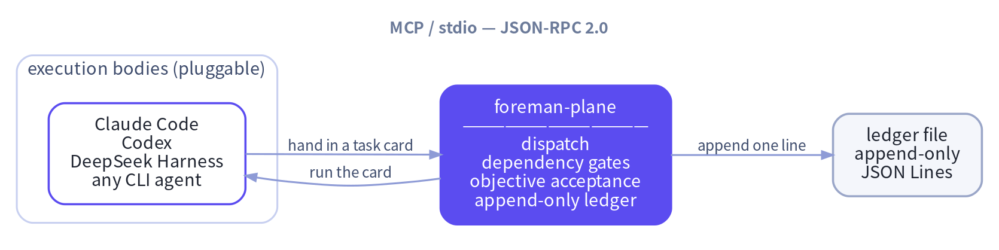
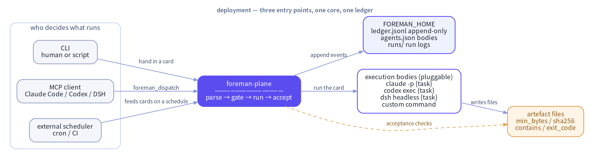
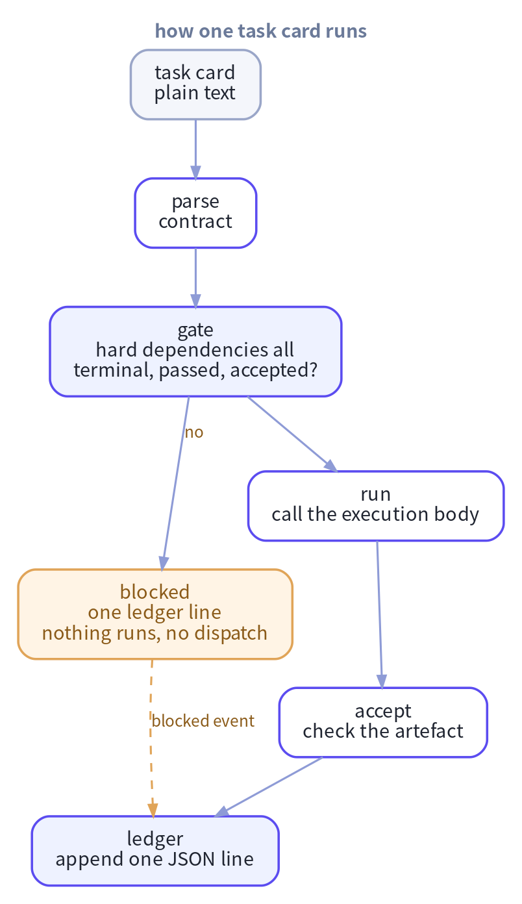

<div align="center">

# foreman-plane

### Task governance outside your agent harness — personal-tool grade

[](https://pypi.org/project/foreman-plane/)
[](https://pypi.org/project/foreman-plane/)


[](https://github.com/Anthony-Vivalink/foreman-plane/actions/workflows/ci.yml)

**English** · [简体中文](README_ZH.md)

</div>

## One sentence

**foreman-plane is a governance plane that runs outside the agent harness.**
[DeepSeek Harness](https://github.com/deepseek-ai/dsh) (DSH), Claude Code,
Codex and any CLI agent are interchangeable
execution bodies. What the plane owns is the part a session cannot own:
dispatch, dependency gating, objective acceptance and an append-only ledger.

> A promise the agent forgot is not a promise. The verdict is derived from files
> on disk, so it outlives the session that produced it.

It is sized for **one person, one machine, one state directory** — a personal
tool, not an enterprise platform. See
[Scope](#scope).



```text
┌──────────────────┐        ┌──────────────────────┐
│ execution bodies │        │ foreman-plane        │
│ Claude Code      │ ─────▶ │ dispatch             │
│ Codex            │        │ dependency gates     │
│ DeepSeek Harness │ ◀───── │ objective acceptance │
│ any CLI agent    │        │ append-only ledger   │
└──────────────────┘        └──────────────────────┘
  MCP / stdio — JSON-RPC 2.0, one JSON object per line
```

* **Cross session** — the ledger outlives every conversation.
* **Cross instance** — several agents share one task graph.
* **Cross day** — a task dispatched today can be resumed tomorrow by any body.
* **Zero intrusion** — the plane is a plain process, no agent framework has to be patched.

Zero third-party dependencies. Python ≥ 3.10, standard library only.

## How this was built

The implementation in this repository was **written by AI coding agents**. I drove them as
headless coding sessions — the same class of pluggable execution body the plane dispatches to
(DeepSeek Harness headless, Claude Code, Codex) — and they produced the code, the tests, the
diagrams and the release pipeline. The **product specification, the acceptance semantics, the
boundary decisions and the release decisions are mine**.

The honest way to read this repository: *the mechanism is machine-written, the rules are
human-set.* Everything the plane trusts — what a task card means, when a task may start, what
counts as done, what must never change — was decided by hand, and every one of those decisions has
a file in this repository that proves it.

| Module / area | Written by | Decided by |
| --- | --- | --- |
| Contract and marker parsing (`foreman_plane.contract`) | the agent | **the author** — which markers exist, and how tolerant parsing must be |
| Gates and verdict semantics (`foreman_plane.gate`, `foreman_plane.acceptance`) | the agent | **the author** — what "done" means: only the artefact on disk, never a self-report |
| Append-only audit ledger (`foreman_plane.ledger`) | the agent | **the author** — events are appended, never rewritten or deleted |
| CLI and MCP tools (`foreman_plane.cli`, `foreman_plane.mcp_server`) | the agent | **the author** — the three tool names and the stable exit codes |
| CI and release pipelines (`.github/workflows/`) | the agent | **the author** — semantic versioning, trusted publishing, no secrets in the release job |
| Documentation and diagrams (`docs/`, `scripts/render_diagrams.py`) | the agent | **the author** — the contract map and the list of what stays unchanged on purpose |
| Test suite (`tests/`) | the agent | **the author** — which behaviours must not regress |
| Examples and packaging (`examples/`, `pyproject.toml`) | the agent | **the author** — the packaging layout and the PEP 639 metadata |

*Written by* = who produced the code. *Decided by* = who set the rule.

Three places in this repository let you check that split yourself:

- [DIVERGENCE.md](DIVERGENCE.md) — the shared-contract map between the local control plane and the
  published package: what is shared, what deliberately differs, and when a local change has to be
  pushed back into the package.
- [CHANGELOG.md](CHANGELOG.md) — the **"Unchanged on purpose"** section under `0.2.0` lists the
  decisions I refused to let a refactor quietly take back.
- [docs/IMPLEMENTATION_REPORT.md](docs/IMPLEMENTATION_REPORT.md) — the acceptance report for
  `v0.1.0`, including the file inventory and the contract the agents had to satisfy.

*A promise the agent forgot is not a promise.*

## Why foreman-plane?

| Capability | What it changes |
| --- | --- |
| **Two-level dependency gate** | A card with `[depends_on]` cannot start until every upstream is terminal, passed and accepted. `[needs_api]` is the soft level: a missing artefact is reported, the task still runs. |
| **Objective acceptance** | Pass and fail are computed from the artefact — `min_bytes`, `sha256`, `contains`, `exit_code`. A task that promises a report but writes no file fails. |
| **No ghost dispatch** | A card stopped by the gate writes a `blocked` event and no `dispatch` event, so the ledger can never show a task that never ran. |
| **Append-only ledger** | One JSON line per decision. History is never rewritten or deleted, and it can be queried, diffed and audited by something that is not an LLM. |
| **Pluggable execution bodies** | The plane picks no model and does not care which command runs a card. Swap the command, keep the governance. |
| **Unparsed dependencies are fatal** | A dependency marker that cannot be parsed refuses the dispatch. It is never silently dropped. |

## Scope

**A personal tool, not an enterprise platform.** foreman-plane is deliberately
small. It is designed for **one person, one machine, one state directory** — not
for a team, a fleet or a regulated org. Saying this out loud is part of the
design: a tool that pretends to be a platform costs you more in configuration
than it saves.

**What it is**

- A plain process. Start it when you need it, stop it when you are done.
- One directory of state (`FOREMAN_HOME`) and one append-only JSONL ledger.
- A handful of interchangeable CLI agents, a few repositories, one task graph.
- State you can read with `cat` and `jq` — no service account, no proprietary store.

**What it is not, and is not going to grow into**

| Not this | Why — and what to use instead |
| --- | --- |
| A multi-tenant platform | No tenancy, no RBAC, no SSO, no audit export. One `FOREMAN_HOME` belongs to one person. |
| A durable workflow engine | No daemon, no queue broker, no timers, no HA, no retries at scale. For resumable long-running workflows use Temporal, Airflow or Argo Workflows. |
| A database | The ledger is a JSONL file — fast and auditable at the scale of one person's tasks, not a sharded store with a query planner. |
| An enterprise audit product | No retention policy engine, no signed reports, no compliance controls. |
| A place for business logic | The plane decides nothing. Your agent owns the work; the plane owns the sequence, the gate and the verdict. |
| A dashboard | The whole surface is CLI, MCP stdio and a Python API. There is no UI and no web server. |

**Why this is a feature**

The tool fits in one directory, starts in milliseconds, and can be read end to
end with a text editor. If your requirement is "our forty-person org needs
approval workflows with SLA clocks and a Postgres-backed audit trail", this is
the wrong tool and you should not spend an afternoon on it. If it is "my agents
keep forgetting what they promised last week and I want a ledger that says so",
it is exactly the right size.

**Where it stops and something else starts**

| If you need | Use |
| --- | --- |
| Durability across days, HA, thousands of concurrent tasks | Temporal / Airflow / Argo Workflows |
| A team-wide approval and audit product | Jira / ServiceNow / a workflow platform with a real admin model |
| Human task tracking and reporting | Beads, or a plain issue tracker |
| A single-machine, dependency-aware, model-free task ledger for your own agents | **foreman-plane** |

**Two code lines, one contract.** This package and the shell-based control
plane it grew out of share the ledger format, the task-card contract and the
acceptance-criteria syntax — but not the execution body. The table above says
where the plane stops; [DIVERGENCE.md](DIVERGENCE.md) records what the two
lines share, what stays local, and the rule for deciding when a fix has to be
released back into the package.

## What it feels like

> You: `Finish these reports first, then let the downstream job merge them.`
>
> foreman-plane: Three cards. The downstream one carries `[depends_on]`, so it
> cannot even start while the upstream files are missing. When everything is
> done the artefacts get checked again, a missing field means `fail`, and the
> ledger records which file fell short.

## Install

```bash
pip install foreman-plane
```

You get two identical commands — use whichever you like:

```bash
foreman-plane --help   # canonical
gongtou --help          # short alias (工头)
```

There is deliberately **no `foreman` command**. That name is already taken by
other projects — an AI orchestration engine on npm, an infrastructure manager
on GitHub — and two packages shipping the same binary name is a real conflict
on `PATH`. The Python package is `foreman_plane`, so it does not collide with
the unrelated `foreman` library on PyPI either.

Or run it straight from a checkout:

```bash
cd foreman-plane
export PYTHONPATH="$PWD/src"
export FOREMAN_HOME="$PWD/.foreman"
```

Ready to run it? **[Deployment](#deployment)** below is the step-by-step:
where the plane keeps its state, which command executes a card, the first
card you hand in, and how to wire it into your harness.

## Deployment

foreman-plane is a plain process, not a service. There is no daemon, no port,
no database and no scheduler. "Deploying" it is three decisions, not a
deployment guide:

| Decision | Where | Default |
| --- | --- | --- |
| Where the plane keeps its state | `FOREMAN_HOME` | `$HOME/.foreman` |
| Which command executes a card | `${FOREMAN_HOME}/agents.json` | the built-in `generic` — empty, so it fails until you define it |
| Who may hand in cards | the caller: a person, a script or an MCP client | — |



### Step 0 — check the install

```bash
pip install foreman-plane
foreman-plane --help
foreman-plane config
```

`foreman-plane` and `gongtou` are the same program. The module entry points are
`python -m foreman_plane.cli` and `python -m foreman_plane.mcp_server`.

`foreman-plane config` prints the effective home, the ledger path, the run directory
and the known execution bodies. Nothing is written yet.

### Step 1 — give the plane a home

```bash
export FOREMAN_HOME=/var/lib/foreman
foreman-plane config
```

Everything the plane owns lives under `FOREMAN_HOME`:

| Path | Written by | Purpose |
| --- | --- | --- |
| `ledger.jsonl` | the plane | the append-only audit ledger — the source of truth |
| `runs/` | the plane | one log file per run: stdout, stderr, exit code |
| `agents.json` | **you** | the execution bodies |

`FOREMAN_HOME` resolves as: the environment variable → `$HOME/.foreman` →
`<cwd>/.foreman`. It works even when `HOME` is not set. The home and `runs/`
are created automatically; `agents.json` is only read, never written for you.

### Step 2 — pick an execution body

```bash
cat > /var/lib/foreman/agents.json <<'JSON'
{
  "agents": {
    "dsh":    {"command": "dsh headless {task}"},
    "claude": {"command": "claude -p {task}"},
    "codex":  {"command": "codex exec {task}"},
    "mybot":  {"command": "mybot run --prompt {task}"}
  }
}
JSON
```

Two placeholders are available: `{task}` — replaced with the whole task card —
and `{workdir}` — replaced with the working directory. **A template without
`{task}` is refused**: the plane will not guess what the agent should be
told, so the run ends with `exit_code: 127` before anything starts.

The command is executed as a subprocess — no shell, so there is no quoting to
get wrong — in the working directory you pass to `dispatch`, under a
wall-clock limit of `FOREMAN_TIMEOUT` seconds (default 900).

The names `claude`, `codex`, `dsh` and `generic` already exist; your
`agents.json` overrides or extends them. `generic` has an empty command, so a
card dispatched to it ends with `exit_code: 127` — the plane never guesses an
agent for you.

### Step 3 — hand in your first card

Every card needs an `[id]`; a card without one is refused
(`task_id_missing`).

```bash
cat > /tmp/card.md <<'MD'
[id] T-20261109-01
[acceptance] reports/report.md::min_bytes=200::contains=Conclusion

Read the notes and write a summary. End it with a "Conclusion" section.
MD

foreman-plane dispatch --file /tmp/card.md --agent dsh --workdir /srv/work
```

The command runs the card to completion and then reports the verdict:

```text
task_id: T-20261109-01
ok: true
verdict: pass
acceptance_ok: true
exit_code: 0
```

`--json` prints the whole receipt instead. Exit codes: `0` success, `2` blocked
by the gate, `3` artefact acceptance failed, `1` anything else.

### Step 4 — let an orchestrator drive it

This is the usual deployment: an agent decides *what* to run, the plane
guarantees *when* and *whether*. The agent talks MCP over stdio — one JSON
object per line, no port, no daemon to keep alive.

**DeepSeek Harness** — no plugin code, just point the profile at the server:

```yaml
# ~/.dsh/profiles/headless/cordis.patch.yml
mcp:
  servers:
    - name: foreman
      command: python3
      args:
        - -m
        - foreman_plane.mcp_server
      env:
        FOREMAN_HOME: /var/lib/foreman
```

**Claude Code, Codex or any MCP client**:

```json
{
  "mcpServers": {
    "foreman": {
      "command": "python3",
      "args": ["-m", "foreman_plane.mcp_server"],
      "env": { "FOREMAN_HOME": "/var/lib/foreman" }
    }
  }
}
```

The orchestrator gets three tools: `foreman_dispatch`, `foreman_status`,
`foreman_cancel`.

### Who decides what gets dispatched

**The plane never decides.** It has no planner, no model, no priority queue
and no scheduler. It executes the cards it is handed and refuses the ones
whose hard dependencies are not met yet.

```text
decides → writes a card → hands it in (CLI / MCP) → plane gates, runs, accepts
```

A blocked card is **not** woken up automatically: once the upstream passes,
the orchestrator (or you) submits the card again. `blocked` is deliberately
not `dispatched`, so a blocked task stays re-dispatchable — otherwise the task
graph would deadlock and the upstream could never unblock it.

### Configuration reference

| Variable | Default | Meaning |
| --- | --- | --- |
| `FOREMAN_HOME` | `$HOME/.foreman` | plane home: ledger, run logs, agents.json |
| `FOREMAN_TIMEOUT` | `900` | execution timeout in seconds |
| `FOREMAN_LEASE` | `900` | lease length in seconds — how long a dispatched task holds the plane |
| `FOREMAN_AGENT` | `generic` | default execution body |
| `FOREMAN_ACTOR` | `foreman` | actor recorded in the ledger |

### What foreman-plane does not do

* No daemon, no scheduler, no cron, no HTTP API, no port to open.
* It does not choose an agent, a model or a priority.
* It does not retry a blocked card for you.
* It does not believe the model about the outcome — only files.

For where this stops being the right tool, see
[Scope](#scope).

### Troubleshooting

| Symptom | What it means | Fix |
| --- | --- | --- |
| exit 2, `dependency_pending` | the upstream has not finished yet | wait for it, then submit the card again |
| exit 2, `dependency_unaccepted` | the upstream ran but its artefact failed | fix the upstream, then re-submit |
| exit 2, `dependency_unknown` | that upstream id was never dispatched | check the id |
| exit 2, `dependency_unparsed` | the `[depends_on]` marker could not be parsed | fix the card — the plane refuses to guess |
| exit 2, `dependency_cycle` | the dependency graph loops | break the cycle |
| exit 2, `duplicate_task` | that id already has a `dispatch` event | a new id, `--force`, or `foreman-plane ledger replan` |
| a task is stuck on `running` | the worker died, the ledger kept its last event | `foreman-plane reclaim` once the lease expired, then dispatch it again |
| `duplicate_task` but the worker is long dead | the lease expired and nobody reclaimed it | `foreman-plane reclaim` — the task becomes `stale` and is dispatchable |
| exit 2, `task_id_missing` | the card has no `[id]` | add one |
| exit 3 | the artefact is missing, too small or missing the marker | read the run log in `runs/` |
| `exit_code: 127`, `no such agent, or its command template is empty` | the agent name is not in `agents.json` | add the agent, or use one of the built-ins |
| `exit_code: 127`, `command template has no {task} placeholder` | the template forgot the placeholder | add `{task}` |
| `exit_code: 127`, `executable is not on PATH` | the command cannot be found | fix `agents.json` or `PATH` |

The CLI exit code and the agent's exit code are different things: `exit 2`
and `exit 3` are the CLI's, while `exit_code:` in the receipt is the
execution body's. Every failed run — including the ones that never started —
leaves a log under `${FOREMAN_HOME}/runs/`, and the receipt carries the tail
of stderr.

## What it actually looks like when it runs

Everything below is real terminal output from a clean checkout — nothing here
is a mock-up. `PYTHONPATH=src` runs the plane straight from the clone,
`FOREMAN_HOME` points at a throw-away state directory, and the execution body
is a two-line shell script that writes one artefact.

```bash
$ export PYTHONPATH=src
$ export FOREMAN_HOME=/tmp/foreman-demo/home
$ python3 -m foreman_plane.cli dispatch --file card.md --agent demo --workdir work
task_id: T-20261122-01
ok: True
verdict: pass
acceptance_ok: True
exit_code: 0

$ python3 -m foreman_plane.cli dispatch --file card_fail.md --agent demo --workdir work
task_id: T-20261122-02
ok: False
verdict: fail
acceptance_ok: False
exit_code: 0

$ python3 -m foreman_plane.cli status
done: 2

$ python3 -m foreman_plane.cli config
FOREMAN_HOME: /tmp/foreman-demo/home
ledger: /tmp/foreman-demo/home/ledger.jsonl
runs_dir: /tmp/foreman-demo/home/runs
timeout_s: 900
default_agent: generic
agents: claude, codex, demo, dsh, generic
```

Read the second dispatch once more. The body ran fine — `exit_code: 0` — and
the verdict is still **fail**, because the artefact did not contain the string
the card demanded. The verdict comes from the file on disk; the exit code and
the agent's own opinion are two more inputs, never the decision.

The ledger keeps all three events of a card — `dispatch`, `running`, `done` —
in one append-only file:

```bash
$ python3 -m foreman_plane.cli ledger show T-20261122-01
{"ts": "2026-11-22T11:10:18.450549+00:00", "event": "dispatch", "task_id": "T-20261122-01", "actor": "foreman", "depends_on": [], "needs_api": [], "acceptance": "reports/demo_report.md::min_bytes=10::contains=verdict", "needs_api_pending": false, "agent": "demo", "workdir": "/tmp/foreman-demo/work", "force": false, "detail": {"depends_on": [], "needs_api": [], "acceptance": "reports/demo_report.md::min_bytes=10::contains=verdict", "needs_api_pending": false, "agent": "demo", "workdir": "/tmp/foreman-demo/work", "force": false}}
{"ts": "2026-11-22T11:10:18.450644+00:00", "event": "running", "task_id": "T-20261122-01", "actor": "foreman", "agent": "demo", "detail": {"agent": "demo"}}
{"ts": "2026-11-22T11:10:18.452546+00:00", "event": "done", "task_id": "T-20261122-01", "actor": "foreman", "verdict": "pass", "acceptance_ok": true, "exit_code": 0, "duration_s": 0.002, "timed_out": false, "agent": "demo", "acceptance_reason": null, "stderr_tail": "", "detail": {"verdict": "pass", "acceptance_ok": true, "exit_code": 0, "duration_s": 0.002, "timed_out": false, "agent": "demo", "acceptance_reason": null, "stderr_tail": ""}}
```

Those two cards and the execution body behind that output:

```text
# card.md
[id] T-20261122-01
[acceptance] reports/demo_report.md::min_bytes=10::contains=verdict

Write the demo report into reports/demo_report.md.
```

```text
# card_fail.md
[id] T-20261122-02
[acceptance] reports/demo_report.md::contains=not-in-the-file

The artefact exists, but it does not contain what the card asked for.
```

```json
{
  "agents": {
    "demo": {
      "command": "/bin/sh -c \"mkdir -p reports && printf 'verdict: green\\n结论: 通过\\n' > reports/demo_report.md && echo 'wrote reports/demo_report.md'\" {task}",
      "description": "demo body that writes an artefact"
    }
  }
}
```

The test suite runs the same way — these are the last lines of a verbose run
(one line per test case, 78 in total):

```bash
$ PYTHONPATH=src python3 -m unittest discover -s tests -v
test_timeout_yields_124 (test_runner.RunnerTests) ... ok
test_unknown_agent_yields_127 (test_runner.RunnerTests) ... ok
test_workdir_placeholder (test_runner.RunnerTests) ... ok

----------------------------------------------------------------------
Ran 78 tests in 2.180s

OK
```

The suite is `unittest`, not `pytest`, on purpose: the package ships zero
third-party dependencies, and the tests must not depend on whether `claude`,
`codex` or `dsh` is installed on your machine.

## The task card

A task card is plain text. Four markers may appear anywhere in it:

| Marker | Meaning |
| --- | --- |
| `[id]` | task id, shaped like `T-YYYYMMDD-NN` |
| `[depends_on]` | **hard** dependency: the upstream must be terminal, passed and accepted |
| `[needs_api]` | **soft** dependency: the artefact only has to exist, not be finished |
| `[acceptance]` | acceptance artefact plus optional objective criteria |

```text
[id] T-20261109-20
[depends_on] T-20261109-01
[needs_api] T-20261109-01#/var/lib/foreman/api/order_book.json
[acceptance] reports/order_book_20261109.md::min_bytes=200::contains=Conclusion

Read order_book.json, produce the report and add a Conclusion section.
```

The half-width bracketed form above is the canonical one. The full-width
variants such as `【id】` and the colon forms such as `id:` are still accepted,
as are full-width spaces and colons. What never happens is a silent drop —
a dependency marker that cannot be parsed refuses the dispatch with
`dependency_unparsed`.

## What the plane guarantees

### How one card runs



```text
  task card
    │
    ├─ parse ──▶ contract: id / hard dependencies / soft dependencies / acceptance criteria
    │
    ├─ gate ───▶ every hard dependency terminal, passed and accepted?
    │              ├─ no  ──▶ blocked: one ledger line, nothing runs, no dispatch event
    │              └─ yes
    │                   ▼
    ├─ run ────▶ call the execution body: Claude Code / Codex / DSH / any command
    │
    ├─ accept ─▶ check the artefact: min_bytes / sha256 / contains / exit_code
    │
    └─ ledger ─▶ append one JSON line: dispatch / running / done / blocked / …
```

### Hard gate — a task never runs too early

A card with `[depends_on]` is released only when every upstream task is
terminal, `verdict=pass` and artefact acceptance passed. Otherwise the plane
writes a `blocked` event and stops. There is no `dispatch` event for a task
that did not run, so the ledger cannot show a ghost dispatch.

```text
[depends_on] T-20261109-01  →  upstream done, verdict=pass   →  released
                             →  upstream still running        →  blocked(dependency_pending)
                             →  upstream unknown               →  blocked(dependency_unknown)
                             →  upstream verdict=fail          →  blocked(dependency_failed)
                             →  unparsable dependency marker   →  blocked(dependency_unparsed)
```

### Soft gate — a task may start without a missing artefact

`[needs_api]` marks artefacts that must be ready but do not have to be
finished. A missing artefact is reported as `needs_api_pending` and the task
still runs.

### Objective acceptance — the artefact decides, not the model

```text
[acceptance] reports/report.md::min_bytes=200::sha256=<hex>::contains=Conclusion
```

Supported criteria: `min_bytes`, `sha256`, `contains`, `exit_code`. All
criteria are ANDed, relative paths resolve against the working directory, and
an unknown criterion fails closed.

### Append-only audit trail

Every decision is one JSON line in `${FOREMAN_HOME}/ledger.jsonl`:

```json
{"ts":"2026-11-09T09:41:02.113456+00:00","event":"dispatch","task_id":"T-20261109-20","actor":"foreman","depends_on":["T-20261109-01"],"needs_api":[],"acceptance":"reports/report.md::min_bytes=200","needs_api_pending":false,"detail":{}}
```

Event types: `dispatch`, `running`, `blocked`, `done`, `cancelled`, `replan`,
plus the failure & recovery events `heartbeat`, `stale`, `checkpoint` and
`retry`. History is never rewritten or deleted.

## Failure & Recovery

A worker that dies used to take the whole task with it. The ledger stopped
on `running`, every re-dispatch was refused as `duplicate_task`, and the only
way out was `--force` — which re-ran every finished step from scratch. This
chapter is the fix: a lease, a reclaim, step checkpoints and a drill that
proves the whole chain.

### What can go wrong

| Failure | What the ledger shows | What the plane does now |
| --- | --- | --- |
| Worker killed with `kill -9` | last event is `running` | the lease expires, `reclaim` marks the task `stale`, it can be dispatched again |
| Worker hangs | last event is `running` | same — the lease is the liveness contract, not the process |
| Worker exits with a retryable code | `done` with `verdict=fail` | optional exponential backoff, one `retry` event per attempt |

The failure model is deliberately small: **one worker, one task, one plane**.
There is no scheduler, no daemon and no quorum — see [Scope](#scope).

### Lease and heartbeat

A successful dispatch takes a **lease**: the ledger records
`lease_expires_at` (UTC ISO8601) and `lease_s` (the length, 900 seconds by
default). While the worker is alive it can push the deadline forward:

```bash
foreman-plane heartbeat T-20261109-20
```

A heartbeat writes one `heartbeat` event and moves the lease. It never
changes the status of the task.

Lease length is configuration, not code:

| Where | How |
| --- | --- |
| environment | `FOREMAN_LEASE=1800` |
| `agents.json` | `"lease_s": 1800` next to the `"agents"` key |
| default | 900 seconds |

### Stale and reclaim

When the lease is over, the task is not lost — it is *stale*. The reclaim
sweep marks every expired task, and only that:

```bash
foreman-plane reclaim --dry-run          # report only, writes nothing
foreman-plane reclaim                     # mark the expired tasks stale
foreman-plane reclaim --task-id T-20261109-20 --now 2026-11-09T12:00:00+00:00
```

The re-dispatch rule follows the state, not the history:

| State of the task | Re-dispatch |
| --- | --- |
| `blocked` | **allowed** — it never entered the plane (unchanged since 0.1.0) |
| `stale` | **allowed** — the lease expired |
| `running` / `dispatched`, lease alive | refused, `duplicate_task` |
| `running` / `dispatched`, lease expired | **allowed** — the worker is presumed dead |
| `done` / `cancelled` | refused, `duplicate_task` (use `--force` or `ledger replan`) |

A task whose lease expired and that is dispatched again without a reclaim
gets a `stale` event first, so the trail always says *why* it ran twice.

### Checkpoints — the work that is already done

An execution body can record that one step is finished:

```bash
foreman-plane checkpoint T-20261109-20 --step "fetch data" --artifact out/raw.json
```

The step name is free text; the ledger only stores it. A re-dispatch hands
the collected step names to the execution body through the optional
`{completed_steps}` placeholder:

```json
{"agents": {"mybot": {"command": "mybot run --task {task} --done {completed_steps}"}}}
```

`{completed_steps}` is replaced by the JSON array of the steps the task
already checkpointed (`["fetch data"]`, or `[]` when there is none). The
receipt repeats it, so "no duplicated work" is checkable without reading the
ledger:

```json
{"completed_steps": ["fetch data"], "skipped_steps": ["fetch data"], "resumed": true}
```

A template without the placeholder keeps working exactly as before — the
placeholder is optional, `{task}` is still mandatory.

### Observability

`foreman-plane status` shows, for every task that is not finished:

```text
$ foreman-plane status --task-id T-20261109-20
task_id: T-20261109-20
status: running
verdict: None
acceptance_ok: None
exit_code: None
last_ts: 2026-11-09T09:41:03.201114+00:00
lease_expires_at: 2026-11-09T09:56:02.113456+00:00
lease_remaining_s: 899.2
age_s: 42.5
completed_steps_count: 1
recoveries: 0
retries: 0
```

`--json` carries the same fields per task, next to the ones that existed
before. Nothing was removed or renamed.

### Backoff retry

Retrying is **off by default** — 0.2.x behaviour is unchanged. Switch it on
per execution body:

```json
{"agents": {"mybot": {
  "command": "mybot run {task}",
  "retry": {"max_attempts": 3, "base_delay_s": 5, "retry_on_exit_codes": [124, 75]}
}}}
```

`max_attempts` counts the total number of attempts, the first run included:
`1` means no retry, `3` means "run at most three times". The delay before
the n-th retry is `base_delay_s * 2 ** (n - 1)`. Every retry writes one
`retry` event (`attempt`, `delay_s`, `exit_code`, stderr tail) and refreshes
the lease — and it never writes a second `dispatch` event, so the task stays
idempotent and the dependency graph counts it once.

### The drill

The whole story runs in one command — no network, no real agent, nothing
outside a throw-away `/tmp` directory:

```bash
scripts/failure_drill.sh
```

It prepares a fake three-step worker, dispatches a card, kills the worker
with `kill -9` half way through, shows the refused re-dispatch, lets the
lease expire, reclaims the task, dispatches it again and checks that the
finished step did **not** run twice. The output of a real run is in
[`docs/failure_drill_sample_output.txt`](docs/failure_drill_sample_output.txt).

### Attempts — the unit of work

Every dispatch is an **attempt**: it has an id, an epoch and its own
artefact directory (`<workdir>/attempts/<task_id>-aNN/`). Two attempts of
the same task never share a directory, so the artefact of a crashed run
can never be mistaken for the artefact of the next one.

```bash
foreman-plane attempts T-20261123-51
```

```
task_id: T-20261123-51
attempt_state: still_running
current_attempt_id: T-20261123-51-a01
late_receipts: 0
  T-20261123-51-a01 epoch=1 status=running verdict=None artifact=None
```

`attempt_state` is derived from the ledger, not guessed: `still_running`
(the lease is alive), `interrupted` (the lease expired without a terminal
event), `outcome_unknown` (a receipt arrived that cannot be attributed —
or the task comes from a 0.2.x ledger that has no lease at all),
`finished` and `not_started`.

**The semantics are at-least-once with an idempotency key — never
exactly-once.** The plane runs an attempt at least once; it does not undo
side effects and it does not promise that a side effect happens only
once. The idempotency key is `(task_id, attempt_id)`: a duplicate
delivery inside one attempt is refused by the ledger, and a duplicate
*side effect* across two attempts is the execution body's job to make
idempotent (writing only into `FOREMAN_ATTEMPT_DIR` is the cheapest way
to do it). About the race itself the plane promises exactly one thing: a
receipt that arrives late is never counted as the success of the current
attempt.

### Explicit retry vs reclaim

Two verbs, two different jobs:

| | `reclaim` | `retry` |
| --- | --- | --- |
| what it does | marks a task whose lease expired as `stale` | allocates a **new attempt** and runs the body again |
| does it execute? | no | yes |
| does it accept an artefact? | no | yes — the artefact of *that* attempt |
| when you need it | the plane crashed, nobody knows whether the worker is alive | you know the task has to run again |

```bash
foreman-plane reclaim --dry-run     # report only
foreman-plane reclaim               # mark the stale ones
foreman-plane retry T-20261123-51   # run it again, as a new attempt
```

`retry` refuses while the current attempt still holds a live lease; pass
`--force` if you really mean it, and `--dry-run` to see what it would do.
Its receipt carries `attempt_id`, `epoch`, `previous_attempt_id` and
`retry_mode: explicit`.

### The acceptance only accepts the current attempt

A relative artefact path is looked up **inside the attempt directory
first** and only then in the base directory, so the acceptance reads the
file *this* attempt produced — not the one a previous attempt left
behind. The receipt records what was really read: `acceptance_path`,
`acceptance_sha256`, `acceptance_size` and `acceptance_checks`.

If the task was cancelled — or a newer attempt took over — while the
worker was running, the late receipt is written to the ledger but **not**
taken for the success of the current attempt: `superseded` is true, with
`superseded_reason` `cancelled_during_run` or
`superseded_by_new_attempt`, and the fold counts it as a `late_receipt`.

```bash
scripts/artifact_gate_drill.sh
```

The drill tells the whole story: the first attempt is killed before it can
write `done`, the second attempt writes its own artefact, the acceptance
takes the second one and only then does the dependent task run. The real
output is in
[`docs/artifact_gate_drill_sample_output.txt`](docs/artifact_gate_drill_sample_output.txt).

### Where this stops

This is still a personal-tool plane: one process, one file, one machine.
There is no multi-tenancy, no RBAC, no high availability and no automatic
supervisor — `reclaim` is something *you* run (from cron, if you like).
The new machinery makes a dead worker recoverable; it does not make the
plane a cluster.

## MCP tools

| Tool | Purpose |
| --- | --- |
| `foreman_dispatch` | dispatch a task card: parse, gate, run, accept |
| `foreman_status` | ledger status of one task or of everything |
| `foreman_cancel` | cancel a task; unknown ids are rejected |

The tool names keep their `foreman_` prefix: they are a namespace inside MCP,
not a binary name, so the CLI rename does not touch them.

## CLI

```
foreman-plane dispatch   --file TASK.md [--agent NAME] [--workdir DIR] [--force] [--json]
foreman-plane status     [--task-id ID] [--json]
foreman-plane heartbeat  TASK_ID [--json]
foreman-plane checkpoint TASK_ID --step NAME [--artifact PATH] [--json]
foreman-plane reclaim    [--task-id ID] [--dry-run] [--now ISO8601] [--json]
foreman-plane attempts  TASK_ID [--json]
foreman-plane retry     TASK_ID [--card PATH] [--reason TEXT] [--force] [--dry-run] [--json]
foreman-plane ledger     list | show | ready | blocked | cancel | replan
foreman-plane verify     --acceptance "<acceptance string>"
foreman-plane mcp
foreman-plane config
```

Exit codes: `0` success, `2` blocked by the gate, `3` artefact acceptance failed,
`1` anything else.

## Development

```bash
PYTHONPATH=src python3 -m unittest discover -s tests -v
```

The specification lives in [`docs/SPEC.md`](docs/SPEC.md), the wire contract in
[`docs/PROTOCOL.md`](docs/PROTOCOL.md).

## License

MIT — see [`LICENSE`](LICENSE).
