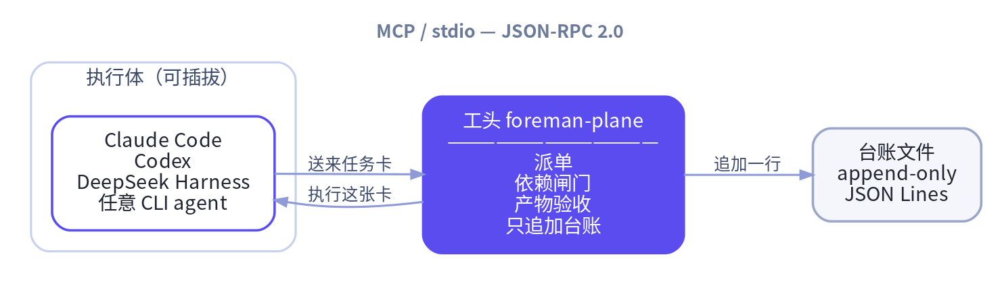
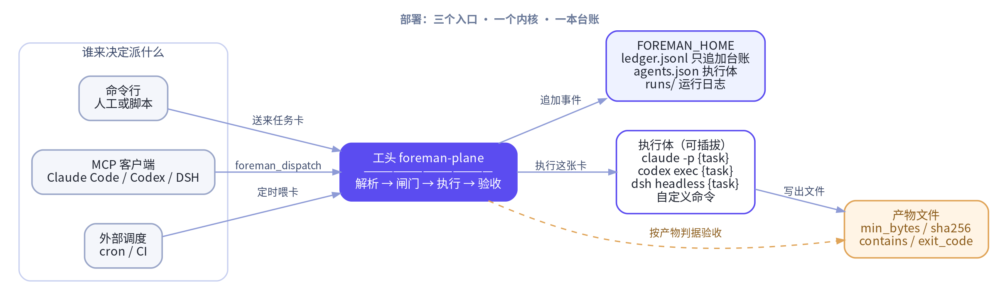
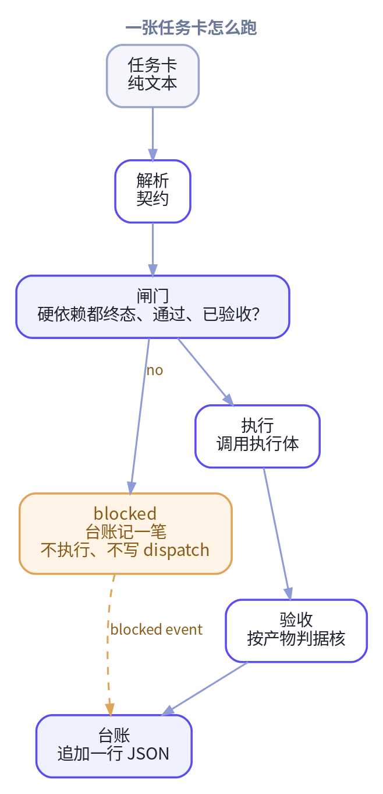

<div align="center">

# 工头 foreman-plane

### 跑在 agent 外面的一层任务治理 —— 个人工具级

[](https://pypi.org/project/foreman-plane/)
[](https://pypi.org/project/foreman-plane/)


[](https://github.com/Anthony-Vivalink/foreman-plane/actions/workflows/ci.yml)

[English](README.md) · **简体中文**

</div>

## 一句话

**工头是一层跑在 agent harness 之外的治理平面。** [DeepSeek Harness](https://github.com/deepseek-ai/dsh)（DSH）、Claude Code、
Codex 或者任意命令行 agent 都只是可插拔的「执行体」；真正被工头掌管的是会话管不了
的那几件事：派单、依赖闸门、客观产物验收，以及一条只追加的审计台账。

> **agent 忘了的承诺不算承诺。** 通过与否只认磁盘上的产物，所以判据活得比产出它的
> 那段会话更久。

它的尺寸是按**「一个人 + 一台机器 + 一个状态目录」**设计的——个人工具级，不是企业级
平台。详见[适用范围](#适用范围)。



```text
┌──────────────────┐        ┌────────────────────┐
│ 执行体（可插拔） │        │ 工头 foreman-plane │
│ Claude Code      │ ─────▶ │ 派单               │
│ Codex            │        │ 依赖闸门           │
│ DeepSeek Harness │ ◀───── │ 产物验收           │
│ 任意 CLI agent   │        │ 只追加台账         │
└──────────────────┘        └────────────────────┘
    MCP / stdio —— JSON-RPC 2.0，一行一个 JSON 对象
```

* **跨会话** —— 台账比任何一段对话都活得久。
* **跨实例** —— 多个 agent 共用同一张任务图。
* **跨天** —— 今天派出去的单，明天任何一个执行体都能接着干。
* **不侵入** —— 工头就是一个普通进程，用它不需要给任何 agent 框架打补丁。

零第三方依赖，Python ≥ 3.10，只用标准库。

## 构建方式（How this was built）

本仓库的实现代码是 **AI 编码代理写的**。我用无头编码会话驱动它们——与工头派单时可插拔的执行体
同一类（DeepSeek Harness headless、Claude Code、Codex）——代码、测试、图示与发布流水线都由它们
产出。而 **产品规格、验收语义、边界取舍与发布决策由我负责**。

这个仓库最诚实的读法是：**机制由机器写，规则由人定。** 工头信得过的每一样东西——任务卡是什么
意思、任务什么时候能开跑、什么算完成、什么永远不能改——都由我拍板，而且每条决策在仓库里都有一份
文件可以对照。

| 模块 / 领域 | 谁写的 | 谁拍板的 |
| --- | --- | --- |
| 契约与 marker 解析（`foreman_plane.contract`） | AI 代理 | **我** —— 有哪几个标记、解析要有多宽容 |
| 闸门与 verdict 语义（`foreman_plane.gate`、`foreman_plane.acceptance`） | AI 代理 | **我** —— 「完成」的定义：只认磁盘上的产物，不认自述 |
| 只追加审计台账（`foreman_plane.ledger`） | AI 代理 | **我** —— 事件只追加，不改写、不删除 |
| CLI 与 MCP 工具（`foreman_plane.cli`、`foreman_plane.mcp_server`） | AI 代理 | **我** —— 三个工具名与稳定的退出码 |
| CI 与发布流水线（`.github/workflows/`） | AI 代理 | **我** —— 语义化版本、trusted publishing、发布作业不落密钥 |
| 文档与图示（`docs/`、`scripts/render_diagrams.py`） | AI 代理 | **我** —— 契约地图与「故意不变」的清单 |
| 测试套件（`tests/`） | AI 代理 | **我** —— 哪些行为不许回退 |
| 示例与打包（`examples/`、`pyproject.toml`） | AI 代理 | **我** —— 打包结构与 PEP 639 元数据 |

*谁写的* = 代码是谁产出的；*谁拍板的* = 规则是谁定的。

仓库里有三处可以自己核对这条分界：

- [DIVERGENCE.md](DIVERGENCE.md) —— 本地控制面与发布包之间的共享契约地图：哪些共享、哪些故意
  不同、什么情况下本地改动要回灌进包。
- [CHANGELOG.md](CHANGELOG.md) —— `0.2.0` 下的 **"Unchanged on purpose"** 一节，列的是我不允许
  被重构悄悄收回的那些决定。
- [docs/IMPLEMENTATION_REPORT.md](docs/IMPLEMENTATION_REPORT.md) —— `v0.1.0` 的验收报告，含文件
  清单与代理必须满足的契约。

> **agent 忘了的承诺不算承诺。**

## 为什么需要工头

| 能力 | 带来的变化 |
| --- | --- |
| **两级依赖闸门** | 带 `[depends_on]` 的单子，上游没终态、没通过、没验收就开不了工；`[needs_api]` 是软闸门，产物没就位只记一笔，任务照跑。 |
| **客观产物验收** | 通过与否由产物算出来——`min_bytes`、`sha256`、`contains`、`exit_code`。嘴上说写了报告、盘上没文件，照样判不通过。 |
| **无幽灵派单** | 被闸门拦下的单子只写 `blocked` 事件、不写 `dispatch` 事件，台账里不会出现没跑过的派单。 |
| **只追加台账** | 每个决策一行 JSON，历史不改写、不删除，能查询、能 diff、能被一个不是大模型的东西审计。 |
| **执行体可插拔** | 工头不选模型，也不关心哪条命令跑这张单；换条命令，治理逻辑照旧。 |
| **依赖解析失败即致命** | 依赖标记解析不出来就拒绝派单，绝不静默丢掉。 |

## 适用范围

**个人工具级，不是企业级平台。** 工头是刻意做小的。它按**「一个人、一台机器、
一个状态目录」**设计——不是给团队、不是给机队、不是给受监管的组织用的。把这一点写在
明面上是设计的一部分：一个假装自己是平台的工具，收回来的配置成本大于省下的事。

**它是什么**

- 一个普通进程：要用的时候起，用完就停。
- 一个状态目录（`FOREMAN_HOME`）加一条只追加的 JSONL 台账。
- 几个可互换的命令行 agent、几个仓库、一张任务图。
- 状态用 `cat`、`jq` 就能读——不需要服务账号，也没有私有存储格式。

**它不是什么，也不会往那个方向长**

| 不是这个 | 为什么，以及你该用啥 |
| --- | --- |
| 多租户平台 | 没有租户、没有 RBAC、没有 SSO、没有审计导出。一个 `FOREMAN_HOME` 只属于一个人。 |
| 持久化工作流引擎 | 没有守护进程、没有消息队列、没有定时器、没有高可用、扛不住大规模重试。要跨天续跑的正式工作流请用 Temporal / Airflow / Argo Workflows。 |
| 数据库 | 台账就是一个 JSONL 文件——在「一个人的任务量」这个尺度上又快又好审，但它不是带查询计划器的分片存储。 |
| 企业级审计产品 | 没有留存策略引擎、没有签名的报告、没有合规控件。 |
| 放业务逻辑的地方 | 工头什么都不决定。干活是 agent 的活儿，工头管的是次序、闸门和判据。 |
| 带界面的控制台 | 全部入口就是 CLI、MCP stdio 和 Python API。没有界面、没有 web 服务。 |

**为什么这算优点**

整个工具就一个目录，毫秒级启动，可以用文本编辑器从头读到尾。如果你的需求是「我们四十人
的组织要带 SLA 计时的审批流、要 Postgres 支撑的审计日志」，那这是错的工具，别在这儿浪费一
个下午；如果需求是「我的 agent 老忘上周答应过什么，我想要一本账能记下来」，那它刚好是那个
尺寸。

**边界在哪，什么该换谁**

| 你要的是 | 用 |
| --- | --- |
| 跨天持久、高可用、几千个并发任务 | Temporal / Airflow / Argo Workflows |
| 团队级审批流与审计产品 | Jira / ServiceNow / 有正经管理模型的流程平台 |
| 人工任务跟踪与报表 | Beads，或者就一个普通的 issue tracker |
| 单机、依赖感知、不带模型的、自己 agent 的任务台账 | **工头 foreman-plane** |

**两条代码线，一套契约。** 这个包和它长出来的那套 shell 控制层共用台账格式、任务卡契约
和验收判据语法，但执行体各走各的。上表讲的是工头在哪停下；
[DIVERGENCE.md](DIVERGENCE.md) 记的是两边共用什么、什么留在本机、以及「一个修复要不要
回灌进包」的判据。

## 装上之后是什么体验

> 你：`这批报告先跑完，跑完再让下游合并`
>
> 工头：拆成三张单。下游那张挂着 `[depends_on]`，上游文件没落地，下游连跑都不跑。
> 全部跑完再对着产物核一遍，缺字段就是 `fail`，台账里写清楚缺在哪个文件。

## 安装

```bash
pip install foreman-plane
```

装出来是两个等价的命令，随你挑：

```bash
foreman-plane --help   # 正名
gongtou --help          # 短别名（工头）
```

**故意不提供 `foreman` 这个命令**：这个名字已经被别的项目占了（npm 上一个 AI 编排引擎、
GitHub 上一个基础设施管理平台），两个包抢同一个可执行文件名，在 `PATH` 上是真冲突。
Python 包名用的是 `foreman_plane`，所以也不会跟 PyPI 上那个不相干的 `foreman` 库撞。

或者从源码目录直接跑：

```bash
cd foreman-plane
export PYTHONPATH="$PWD/src"
export FOREMAN_HOME="$PWD/.foreman"
```

装好了就照着走？下面的 **[部署](#部署)** 是逐步的：工头把状态放哪、用哪条命令执行任务卡、第一张卡怎么递、怎么接进你的 harness。

## 部署

foreman-plane 是个普通进程，不是服务：没有守护进程、没有端口、没有数据库、没有调度器。所谓「部署」其实是做三个决定：

| 决定 | 在哪 | 默认 |
| --- | --- | --- |
| 工头把状态放在哪 | `FOREMAN_HOME` | `$HOME/.foreman` |
| 用哪条命令执行任务卡 | `${FOREMAN_HOME}/agents.json` | 内置的 `generic`——命令是空的，不配就跑不了 |
| 谁能递任务卡进来 | 调用方：人、脚本或 MCP 客户端 | — |



### 第 0 步 —— 先确认装上了

```bash
pip install foreman-plane
foreman-plane --help
foreman-plane config
```

`foreman-plane` 和 `gongtou` 是同一个程序。模块入口分别是
`python -m foreman_plane.cli` 和 `python -m foreman_plane.mcp_server`。

`foreman-plane config` 会打印当前生效的主目录、台账路径、运行日志目录和已知的执行体。这一步还不写任何文件。

### 第 1 步 —— 给工头一个家

```bash
export FOREMAN_HOME=/var/lib/foreman
foreman-plane config
```

工头自己的东西全在 `FOREMAN_HOME` 底下：

| 路径 | 谁写 | 用途 |
| --- | --- | --- |
| `ledger.jsonl` | 工头 | 只追加的审计台账，唯一事实来源 |
| `runs/` | 工头 | 每次运行一个日志文件：stdout、stderr、退出码 |
| `agents.json` | **你** | 执行体配置 |

`FOREMAN_HOME` 的解析顺序：环境变量 → `$HOME/.foreman` → `<cwd>/.foreman`；`HOME` 没设也不会崩。主目录和 `runs/` 会自动建出来，`agents.json` 只读、不会替你生成。

### 第 2 步 —— 选一个执行体

```bash
cat > /var/lib/foreman/agents.json <<'JSON'
{
  "agents": {
    "dsh":    {"command": "dsh headless {task}"},
    "claude": {"command": "claude -p {task}"},
    "codex":  {"command": "codex exec {task}"},
    "mybot":  {"command": "mybot run --prompt {task}"}
  }
}
JSON
```

有两个占位符可用：`{task}`——替换成整张任务卡；`{workdir}`——替换成工作目录。**模板里没有 `{task}` 会被拒绝**：工头不猜该把什么喂给 agent，所以这次运行在启动之前就以 `exit_code: 127` 收场。

命令以子进程方式执行（不过 shell，所以没有引号坑），工作目录就是 `dispatch` 时传的那个，时长上限 `FOREMAN_TIMEOUT` 秒（默认 900）。

`claude` / `codex` / `dsh` / `generic` 这四个名字内置就有，你的 `agents.json` 可以覆盖或扩展它们。`generic` 的命令是空的，所以派给它会以 `exit_code: 127` 收场——工头绝不替你猜该用哪个 agent。

### 第 3 步 —— 递第一张卡

每张卡都必须有 `[id]`，没有会被拒（`task_id_missing`）。

```bash
cat > /tmp/card.md <<'MD'
[id] T-20261109-01
[acceptance] reports/report.md::min_bytes=200::contains=Conclusion

读一下笔记写个总结，最后加一节 "Conclusion"。
MD

foreman-plane dispatch --file /tmp/card.md --agent dsh --workdir /srv/work
```

命令会把这张卡跑到结束，然后给出裁决：

```text
task_id: T-20261109-01
ok: true
verdict: pass
acceptance_ok: true
exit_code: 0
```

加 `--json` 打印完整回执。退出码：`0` 成功、`2` 被闸门拦下、`3` 产物验收不过、`1` 其它错误。

### 第 4 步 —— 让编排器来驱动

这才是常见部署姿势：**agent 决定「跑什么」，工头保证「什么时候跑、算不算跑成」**。agent 通过 MCP over stdio 说话——一行一个 JSON 对象，不用开端口，也不用养守护进程。

**DeepSeek Harness**：不用写插件代码，把 profile 指到这个 stdio 服务即可：

```yaml
# ~/.dsh/profiles/headless/cordis.patch.yml
mcp:
  servers:
    - name: foreman
      command: python3
      args:
        - -m
        - foreman_plane.mcp_server
      env:
        FOREMAN_HOME: /var/lib/foreman
```

**Claude Code、Codex 或任意 MCP 客户端**：

```json
{
  "mcpServers": {
    "foreman": {
      "command": "python3",
      "args": ["-m", "foreman_plane.mcp_server"],
      "env": { "FOREMAN_HOME": "/var/lib/foreman" }
    }
  }
}
```

编排器拿到三个工具：`foreman_dispatch`、`foreman_status`、`foreman_cancel`。

### 到底谁决定派发

**工头自己不做任何决定。** 它没有 planner、没有模型、没有优先级队列、没有调度器；它只执行递进来的卡，并拒掉硬依赖还没满足的卡。

```text
做决定 → 写卡 → 递进来（CLI / MCP）→ 工头把关、执行、验收
```

被拦下的卡**不会自动醒过来**：上游通过之后，要由编排方（或你）再递一次这张卡。`blocked` 刻意不等于 `dispatched`，所以被拦下的卡始终可以重新派——否则任务图会死锁，上游永远解不开它。

### 配置总表

| 变量 | 默认 | 含义 |
| --- | --- | --- |
| `FOREMAN_HOME` | `$HOME/.foreman` | 工头主目录：台账、运行日志、agents.json |
| `FOREMAN_TIMEOUT` | `900` | 执行超时秒数 |
| `FOREMAN_LEASE` | `900` | 租约秒数——派出去的任务能占住平面多久 |
| `FOREMAN_AGENT` | `generic` | 默认执行体 |
| `FOREMAN_ACTOR` | `foreman` | 台账里记录的 actor |

### 工头不做什么

* 没有守护进程、没有调度器、没有 cron、没有 HTTP API、没有要开的端口。
* 不替你选 agent、模型或优先级。
* 不替你重试被拦下的卡。
* 不信模型对结果的自述——只信文件。

什么情况下它就不该是你要找的东西，见[适用范围](#适用范围)。

### 出问题怎么查

| 现象 | 什么意思 | 怎么办 |
| --- | --- | --- |
| 退出码 2，`dependency_pending` | 上游还没跑完 | 等上游，再递一次这张卡 |
| 退出码 2，`dependency_unaccepted` | 上游跑了但产物没验收过 | 修上游，再递一次 |
| 退出码 2，`dependency_unknown` | 上游那个 id 从没被派过 | 检查 id 拼写 |
| 退出码 2，`dependency_unparsed` | `[depends_on]` 标记解析不了 | 改卡——工头拒绝猜 |
| 退出码 2，`dependency_cycle` | 依赖图成环 | 断环 |
| 退出码 2，`duplicate_task` | 这个 id 已经有 `dispatch` 事件了 | 换 id、加 `--force`，或 `foreman-plane ledger replan` |
| 任务卡在 `running` | worker 死了，台账停在最后一条事件 | 租约到期后跑 `foreman-plane reclaim`，再重新派单 |
| 报 `duplicate_task` 但 worker 早就死了 | 租约过期了还没人回收 | `foreman-plane reclaim`——任务变 `stale`，就能再派了 |
| 退出码 2，`task_id_missing` | 卡里没有 `[id]` | 补上 |
| 退出码 3 | 产物缺失、太小或缺标记 | 看 `runs/` 里那次运行的日志 |
| `exit_code: 127`，`no such agent, or its command template is empty` | `agents.json` 里没这个 agent | 加上这个 agent，或用内置的 |
| `exit_code: 127`，`command template has no {task} placeholder` | 模板漏了占位符 | 补上 `{task}` |
| `exit_code: 127`，`executable is not on PATH` | 找不到这条命令 | 改 `agents.json` 或 `PATH` |

CLI 的退出码和执行体的退出码是两回事：`退出码 2`、`退出码 3` 是 CLI 的，回执里的 `exit_code:` 是执行体的。每一次失败的运行——包括根本没跑起来的那些——都会在 `${FOREMAN_HOME}/runs/` 下留一份日志，回执里也会带上 stderr 的尾巴。

## 真跑起来长什么样

下面全是干净检出后的**真实终端输出**，不是编出来的示意。`PYTHONPATH=src` 直接从
源码目录跑，`FOREMAN_HOME` 指向一个一次性的状态目录，执行体是一个只负责写一个
产物的两行 shell 脚本。

```bash
$ export PYTHONPATH=src
$ export FOREMAN_HOME=/tmp/foreman-demo/home
$ python3 -m foreman_plane.cli dispatch --file card.md --agent demo --workdir work
task_id: T-20261122-01
ok: True
verdict: pass
acceptance_ok: True
exit_code: 0

$ python3 -m foreman_plane.cli dispatch --file card_fail.md --agent demo --workdir work
task_id: T-20261122-02
ok: False
verdict: fail
acceptance_ok: False
exit_code: 0

$ python3 -m foreman_plane.cli status
done: 2

$ python3 -m foreman_plane.cli config
FOREMAN_HOME: /tmp/foreman-demo/home
ledger: /tmp/foreman-demo/home/ledger.jsonl
runs_dir: /tmp/foreman-demo/home/runs
timeout_s: 900
default_agent: generic
agents: claude, codex, demo, dsh, generic
```

第二张派单请再看一遍：执行体本身跑成功了——`exit_code: 0`——但结论仍然是
**fail**，因为产物里没有卡里要求的那段字符串。结论只认磁盘上的文件；退出码和
agent 的自述只是另外两个输入，永远不是判据本身。

台账把一张卡的三个事件——`dispatch`、`running`、`done`——写进同一个只追加的文件：

```bash
$ python3 -m foreman_plane.cli ledger show T-20261122-01
{"ts": "2026-11-22T11:10:18.450549+00:00", "event": "dispatch", "task_id": "T-20261122-01", "actor": "foreman", "depends_on": [], "needs_api": [], "acceptance": "reports/demo_report.md::min_bytes=10::contains=verdict", "needs_api_pending": false, "agent": "demo", "workdir": "/tmp/foreman-demo/work", "force": false, "detail": {"depends_on": [], "needs_api": [], "acceptance": "reports/demo_report.md::min_bytes=10::contains=verdict", "needs_api_pending": false, "agent": "demo", "workdir": "/tmp/foreman-demo/work", "force": false}}
{"ts": "2026-11-22T11:10:18.450644+00:00", "event": "running", "task_id": "T-20261122-01", "actor": "foreman", "agent": "demo", "detail": {"agent": "demo"}}
{"ts": "2026-11-22T11:10:18.452546+00:00", "event": "done", "task_id": "T-20261122-01", "actor": "foreman", "verdict": "pass", "acceptance_ok": true, "exit_code": 0, "duration_s": 0.002, "timed_out": false, "agent": "demo", "acceptance_reason": null, "stderr_tail": "", "detail": {"verdict": "pass", "acceptance_ok": true, "exit_code": 0, "duration_s": 0.002, "timed_out": false, "agent": "demo", "acceptance_reason": null, "stderr_tail": ""}}
```

上面那两张卡，以及背后那个执行体：

```text
# card.md
[id] T-20261122-01
[acceptance] reports/demo_report.md::min_bytes=10::contains=verdict

Write the demo report into reports/demo_report.md.
```

```text
# card_fail.md
[id] T-20261122-02
[acceptance] reports/demo_report.md::contains=not-in-the-file

The artefact exists, but it does not contain what the card asked for.
```

```json
{
  "agents": {
    "demo": {
      "command": "/bin/sh -c \"mkdir -p reports && printf 'verdict: green\\n结论: 通过\\n' > reports/demo_report.md && echo 'wrote reports/demo_report.md'\" {task}",
      "description": "demo body that writes an artefact"
    }
  }
}
```

测试也是同一条命令跑——下面是一次 verbose 运行的**末尾几行**（每行一个用例，
一共 78 个）：

```bash
$ PYTHONPATH=src python3 -m unittest discover -s tests -v
test_timeout_yields_124 (test_runner.RunnerTests) ... ok
test_unknown_agent_yields_127 (test_runner.RunnerTests) ... ok
test_workdir_placeholder (test_runner.RunnerTests) ... ok

----------------------------------------------------------------------
Ran 78 tests in 2.180s

OK
```

测试用的是 `unittest` 而不是 `pytest`，这是刻意的：这个包零第三方依赖，而且测试
不许依赖你机器上到底装没装 `claude`、`codex` 或 `dsh`。

## 任务卡契约

任务卡就是一段纯文本，四个标记可以出现在任何位置：

| 标记 | 含义 |
| --- | --- |
| `[id]` | 任务号，形如 `T-YYYYMMDD-NN` |
| `[depends_on]` | **硬依赖**：上游必须已终态、已通过、已验收 |
| `[needs_api]` | **软依赖**：相关产物就位即可开工，不要求完工 |
| `[acceptance]` | 验收产物路径，外加可选的客观判据 |

```text
[id] T-20261109-20
[depends_on] T-20261109-01
[needs_api] T-20261109-01#/var/lib/foreman/api/order_book.json
[acceptance] reports/order_book_20261109.md::min_bytes=200::contains=结论

请读取 order_book.json，产出分析报告并给出结论小节。
```

上面这种半角方括号是规范写法。全角写法 `【id】`、冒号写法 `id:`、全角空格和全角冒号
也都认。但**绝不静默丢弃**——依赖标记解析不出来，这张单会被 `dependency_unparsed`
直接拒掉。

## 工头保证什么

### 一张单怎么跑



```text
  任务卡
    │
    ├─ 解析 ──▶ 契约：id / 硬依赖 / 软依赖 / 验收判据
    │
    ├─ 闸门 ──▶ 硬依赖是否全部终态、通过、已验收？
    │              ├─ 否 ──▶ blocked：台账记一笔，不执行，也不写 dispatch
    │              └─ 是
    │                   ▼
    ├─ 执行 ──▶ 调用执行体：Claude Code / Codex / DSH / 任意命令
    │
    ├─ 验收 ──▶ 按产物判据核：min_bytes / sha256 / contains / exit_code
    │
    └─ 台账 ──▶ 追加一行 JSON：dispatch / running / done / blocked / …
```

### 硬闸门 —— 任务绝不可能提前开跑

带 `[depends_on]` 的单子，只有当每个上游都终态、`verdict=pass`、产物验收也过，
才会被放行。否则工头只写一条 `blocked` 事件就停下——被拦下的单子**不会有**
`dispatch` 事件，台账里不会出现幽灵派单。

```text
[depends_on] T-20261109-01  →  上游 done 且 verdict=pass  →  放行执行
                             →  上游还在 running             →  blocked(dependency_pending)
                             →  上游查无此单                 →  blocked(dependency_unknown)
                             →  上游 verdict=fail            →  blocked(dependency_failed)
                             →  依赖标记解析不出来           →  blocked(dependency_unparsed)
```

### 软闸门 —— 产物没到位也允许开工

`[needs_api]` 标的是「要就位但不要求完工」的产物。缺了就记 `needs_api_pending`，
任务照跑不误。

### 客观验收 —— 产物说话，不看模型自述

```text
[acceptance] reports/report.md::min_bytes=200::sha256=<hex>::contains=结论
```

支持的判据：`min_bytes`、`sha256`、`contains`、`exit_code`。多个判据是「与」的关系，
相对路径按工作目录解析，遇到不认识的判据一律判不通过——宁可严，不许松。

### 只追加的审计台账

每一个决策都是 `${FOREMAN_HOME}/ledger.jsonl` 里的一行 JSON：

```json
{"ts":"2026-11-09T09:41:02.113456+00:00","event":"dispatch","task_id":"T-20261109-20","actor":"foreman","depends_on":["T-20261109-01"],"needs_api":[],"acceptance":"reports/report.md::min_bytes=200","needs_api_pending":false,"detail":{}}
```

事件类型：`dispatch`、`running`、`blocked`、`done`、`cancelled`、`replan`，
外加故障恢复那几类：`heartbeat`、`stale`、`checkpoint`、`retry`。
历史只追加，不改写、不删除。

## 故障恢复

以前 worker 一死，整张卡就跟着死了：台账停在 `running`，再派单被判 `duplicate_task` 拒掉，
唯一的出路是 `--force`——而 `--force` 会把已经做完的步骤从头再跑一遍。这一章就是修这个：
租约、回收、步骤 checkpoint，以及一条能真跑的演练。

### 会出什么事

| 故障 | 台账长什么样 | 现在的处理 |
| --- | --- | --- |
| worker 被 `kill -9` | 最后一条事件停在 `running` | 租约到期 → `reclaim` 标成 `stale` → 可以再派 |
| worker 卡死不动 | 最后一条事件停在 `running` | 同上——租约才是活着的凭据，不是进程 |
| worker 退出码可重试 | `done` 且 `verdict=fail` | 可选的指数退避重试，每次一条 `retry` 事件 |

故障模型就那么大：**一个 worker、一张卡、一个平面**。没有调度器、没有守护进程、没有仲裁——
见[适用范围](#适用范围)。

### 租约与心跳

派单成功就占一份**租约**：台账里记 `lease_expires_at`（UTC ISO8601）和 `lease_s`
（租约长度，默认 900 秒）。worker 活着的时候可以自己续：

```bash
foreman-plane heartbeat T-20261109-20
```

心跳只写一条 `heartbeat` 事件、把租约往后推，**不改变任务状态**。

租约长度是配置，不是代码：

| 位置 | 怎么写 |
| --- | --- |
| 环境变量 | `FOREMAN_LEASE=1800` |
| `agents.json` | 与 `"agents"` 同级写 `"lease_s": 1800` |
| 默认 | 900 秒 |

### 陈旧与回收

租约过了不代表任务丢了，它只是**陈旧**了。回收会把过期的任务标成 `stale`，而且只标这些：

```bash
foreman-plane reclaim --dry-run          # 只报告，不写台账
foreman-plane reclaim                     # 把过期的标成 stale
foreman-plane reclaim --task-id T-20261109-20 --now 2026-11-09T12:00:00+00:00
```

再派单的规则看**当前状态**，不再看历史：

| 任务状态 | 能不能再派 |
| --- | --- |
| `blocked` | **能**——它从没进过平面（0.1.0 起的规矩没变） |
| `stale` | **能**——租约到期了 |
| `running` / `dispatched`，租约还在 | 拒，`duplicate_task` |
| `running` / `dispatched`，租约已过 | **能**——默认 worker 已经死了 |
| `done` / `cancelled` | 拒，`duplicate_task`（要 `--force` 或 `ledger replan`） |

租约到期却没先跑 `reclaim` 就直接再派，台账会先补一条 `stale`，让痕迹说清楚「为什么它跑了第二遍」。

### checkpoint —— 已经做完的活

执行体可以随时记一步做完了：

```bash
foreman-plane checkpoint T-20261109-20 --step "抓数据" --artifact out/raw.json
```

步骤名是自由文本，台账只存名字。再派单时，这些步骤名会通过可选的 `{completed_steps}`
占位符交给执行体：

```json
{"agents": {"mybot": {"command": "mybot run --task {task} --done {completed_steps}"}}}
```

`{completed_steps}` 会被替换成已 checkpoint 的步骤名 JSON 数组（`["抓数据"]`；没有就是 `[]`）。
回执里也会重复一遍，于是「没有重复干活」不用翻台账就能验证：

```json
{"completed_steps": ["抓数据"], "skipped_steps": ["抓数据"], "resumed": true}
```

模板里**不写**这个占位符也完全照旧能用——占位符是可选的，`{task}` 依然是必填项。

### 可观测

`foreman-plane status` 对每个没结束的任务都能看出：

```text
$ foreman-plane status --task-id T-20261109-20
task_id: T-20261109-20
status: running
verdict: None
acceptance_ok: None
exit_code: None
last_ts: 2026-11-09T09:41:03.201114+00:00
lease_expires_at: 2026-11-09T09:56:02.113456+00:00
lease_remaining_s: 899.2
age_s: 42.5
completed_steps_count: 1
recoveries: 0
retries: 0
```

`--json` 里每个任务也带这些字段，和老字段并存——没有删字段，也没有改语义。

### 退避重试

重试**默认关闭**，0.2.x 的行为一点没变。要开就按执行体单独配：

```json
{"agents": {"mybot": {
  "command": "mybot run {task}",
  "retry": {"max_attempts": 3, "base_delay_s": 5, "retry_on_exit_codes": [124, 75]}
}}}
```

`max_attempts` 是**总次数**（含第一次）：`1` 就是不重试，`3` 就是最多跑三次。
第 n 次重试前的等待是 `base_delay_s * 2 ** (n - 1)`。每次重试写一条 `retry` 事件
（`attempt`、`delay_s`、`exit_code`、stderr 尾巴）并顺手续一次租约；重试**不会**产生第二条
`dispatch` 事件，所以任务还是幂等的，依赖图里也只算它一次。

### 演练

整个故事一条命令跑完——不联网、不用真 agent、不碰 `/tmp` 以外的任何地方：

```bash
scripts/failure_drill.sh
```

它会造一个假的三步 worker，派一张卡，在第二步用 `kill -9` 把 worker 打死，展示被拒的
再派单，让租约过期，回收任务，再派一次，并检查做完的那一步**没有**跑第二遍。
一次真跑的输出在 [`docs/failure_drill_sample_output.txt`](docs/failure_drill_sample_output.txt)。

### attempt —— 工作单元

每次派单都是一个 **attempt**：有 id、有 epoch、有自己的产物目录
（`<workdir>/attempts/<task_id>-aNN/`）。同一个任务的两次 attempt 不共用目录，
所以崩掉那次留下的产物，绝不会被当成下一次跑出来的产物。

```bash
foreman-plane attempts T-20261123-51
```

```
task_id: T-20261123-51
attempt_state: still_running
current_attempt_id: T-20261123-51-a01
late_receipts: 0
  T-20261123-51-a01 epoch=1 status=running verdict=None artifact=None
```

`attempt_state` 是从台账**推**出来的，不是猜的：`still_running`（租约还活着）、
`interrupted`（租约过期却没有终态事件）、`outcome_unknown`（来了一没法归属的回执，
或者这是 0.2.x 老台账、压根没有租约）、`finished`、`not_started`。

**语义是 at-least-once + 幂等键，永远不是 exactly-once。** 平面保证一个 attempt 至少跑一次；
它不回滚副作用，也不承诺副作用只发生一次。幂等键是 `(task_id, attempt_id)`：同一个 attempt 内
的重复投递由台账幂等判定挡住；跨 attempt 的重复副作用要**执行体自己**保证幂等（只往
`FOREMAN_ATTEMPT_DIR` 里写，是最省事的做法）。关于竞态，平面只承诺一件事：**迟到的回执
永远不会被算成当前 attempt 的成功**。

### 显式重试 与 回收 不是一回事

两个词，两件事：

| | `reclaim`（回收） | `retry`（显式重试） |
| --- | --- | --- |
| 做什么 | 把租约过期的任务标成 `stale` | 分配一个**新 attempt**，把执行体再跑一遍 |
| 会执行吗 | 不会 | 会 |
| 会验收产物吗 | 不会 | 会 —— 验收**这一次** attempt 的产物 |
| 什么时候用 | 平面崩了，不知道 worker 死没死 | 你已经确定这活儿得再跑一遍 |

```bash
foreman-plane reclaim --dry-run     # 只报告
foreman-plane reclaim               # 真的标 stale
foreman-plane retry T-20261123-51   # 再跑一次，换一个新 attempt
```

当前 attempt 还占着有效租约时，`retry` 会拒绝；要硬来就加 `--force`，想先看看会发生什么就
加 `--dry-run`。它的回执里带 `attempt_id`、`epoch`、`previous_attempt_id` 和
`retry_mode: explicit`。

### 验收只认本次 attempt 的产物

产物的相对路径**先在 attempt 目录里找**，找不到才回落到 base 目录 —— 所以验收读到的必然是
**这一次**跑出来的文件，而不是上一次留下的。回执里会记下到底读了什么：`acceptance_path`、
`acceptance_sha256`、`acceptance_size`、`acceptance_checks`。

如果 worker 还在跑的时候任务被取消了（或者被更新的 attempt 接过），那个迟到的回执**会**写进
台账，但**不会**被当成当前 attempt 的成功：`superseded` 为 true，`superseded_reason` 是
`cancelled_during_run` 或 `superseded_by_new_attempt`，折叠时把它记成一次 `late_receipt`。

```bash
scripts/artifact_gate_drill.sh
```

整个故事在演练里跑给你看：第一次 attempt 在写 `done` 之前被打死，第二次 attempt 写出自己的
产物，验收只认第二次，然后依赖它的任务才开跑。真实输出见
[`docs/artifact_gate_drill_sample_output.txt`](docs/artifact_gate_drill_sample_output.txt)。

### 这一章的边界

它仍然是个人工具级的平面：一个进程、一个文件、一台机器。没有多租户、没有 RBAC、没有高可用、
没有自动看护——`reclaim` 得你自己跑（挂 cron 也行）。新机制让「worker 死了」可恢复，
但它没把这个平面变成集群。

## MCP 工具

| 工具 | 用途 |
| --- | --- |
| `foreman_dispatch` | 派单：解析契约 → 过闸门 → 执行 → 验收 |
| `foreman_status` | 查某个任务或全局的台账状态 |
| `foreman_cancel` | 取消任务，不存在的任务号会被拒绝 |

工具名保留 `foreman_` 前缀：它是 MCP 内部的命名空间，不是可执行文件名，所以命令行改名
不影响它们。

## 命令行

```
foreman-plane dispatch   --file TASK.md [--agent NAME] [--workdir DIR] [--force] [--json]
foreman-plane status     [--task-id ID] [--json]
foreman-plane heartbeat  TASK_ID [--json]
foreman-plane checkpoint TASK_ID --step NAME [--artifact PATH] [--json]
foreman-plane reclaim    [--task-id ID] [--dry-run] [--now ISO8601] [--json]
foreman-plane attempts  TASK_ID [--json]
foreman-plane retry     TASK_ID [--card PATH] [--reason TEXT] [--force] [--dry-run] [--json]
foreman-plane ledger     list | show | ready | blocked | cancel | replan
foreman-plane verify     --acceptance "<验收串>"
foreman-plane mcp
foreman-plane config
```

退出码：`0` 成功 · `2` 被闸门拦下 · `3` 产物验收不通过 · `1` 其它错误。

## 开发

```bash
PYTHONPATH=src python3 -m unittest discover -s tests -v
```

规格原文见 [`docs/SPEC.md`](docs/SPEC.md)，协议细节见 [`docs/PROTOCOL.md`](docs/PROTOCOL.md)。

## 许可证

MIT，见 [`LICENSE`](LICENSE)。
