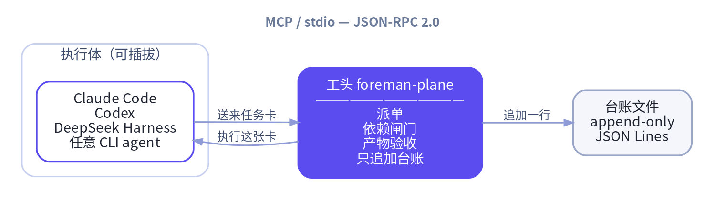
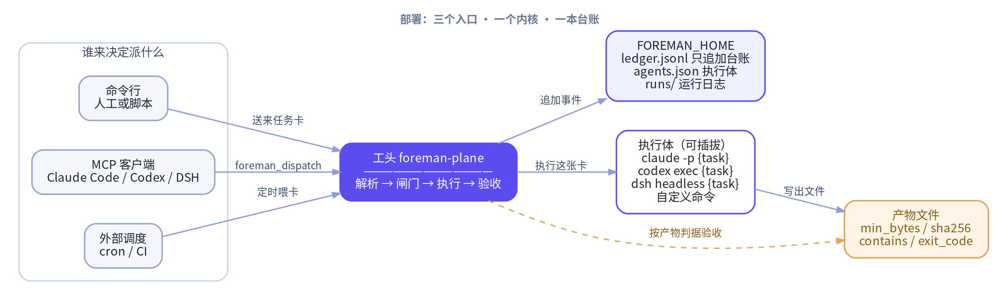
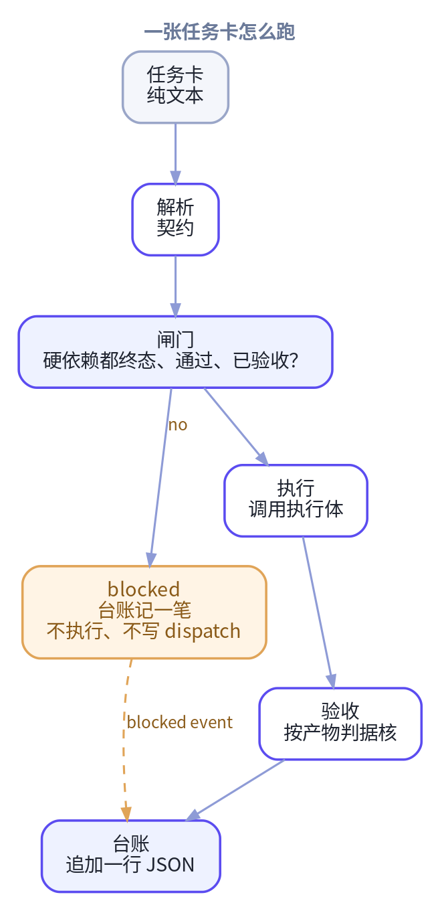

<div align="center">

# 工头 foreman-plane

### 让任务治理跑在 agent 外面

[](https://pypi.org/project/foreman-plane/)
[](https://pypi.org/project/foreman-plane/)


[English](README.md) · **简体中文**

</div>

## 一句话

**工头是一层跑在 agent harness 之外的治理平面。** DeepSeek Harness、Claude Code、
Codex 或者任意命令行 agent 都只是可插拔的「执行体」；真正被工头掌管的是会话管不了
的那几件事：派单、依赖闸门、客观产物验收，以及一条只追加的审计台账。

> **agent 忘了的承诺不算承诺。** 通过与否只认磁盘上的产物，所以判据活得比产出它的
> 那段会话更久。



```text
┌──────────────────┐        ┌────────────────────┐
│ 执行体（可插拔） │        │ 工头 foreman-plane │
│ Claude Code      │ ─────▶ │ 派单               │
│ Codex            │        │ 依赖闸门           │
│ DeepSeek Harness │ ◀───── │ 产物验收           │
│ 任意 CLI agent   │        │ 只追加台账         │
└──────────────────┘        └────────────────────┘
    MCP / stdio —— JSON-RPC 2.0，一行一个 JSON 对象
```

* **跨会话** —— 台账比任何一段对话都活得久。
* **跨实例** —— 多个 agent 共用同一张任务图。
* **跨天** —— 今天派出去的单，明天任何一个执行体都能接着干。
* **不侵入** —— 工头就是一个普通进程，用它不需要给任何 agent 框架打补丁。

零第三方依赖，Python ≥ 3.10，只用标准库。

## 为什么需要工头

| 能力 | 带来的变化 |
| --- | --- |
| **两级依赖闸门** | 带 `[depends_on]` 的单子，上游没终态、没通过、没验收就开不了工；`[needs_api]` 是软闸门，产物没就位只记一笔，任务照跑。 |
| **客观产物验收** | 通过与否由产物算出来——`min_bytes`、`sha256`、`contains`、`exit_code`。嘴上说写了报告、盘上没文件，照样判不通过。 |
| **无幽灵派单** | 被闸门拦下的单子只写 `blocked` 事件、不写 `dispatch` 事件，台账里不会出现没跑过的派单。 |
| **只追加台账** | 每个决策一行 JSON，历史不改写、不删除，能查询、能 diff、能被一个不是大模型的东西审计。 |
| **执行体可插拔** | 工头不选模型，也不关心哪条命令跑这张单；换条命令，治理逻辑照旧。 |
| **依赖解析失败即致命** | 依赖标记解析不出来就拒绝派单，绝不静默丢掉。 |

## 装上之后是什么体验

> 你：`这批报告先跑完，跑完再让下游合并`
>
> 工头：拆成三张单。下游那张挂着 `[depends_on]`，上游文件没落地，下游连跑都不跑。
> 全部跑完再对着产物核一遍，缺字段就是 `fail`，台账里写清楚缺在哪个文件。

## 安装

```bash
pip install foreman-plane
```

或者从源码目录直接跑：

```bash
cd foreman-plane
export PYTHONPATH="$PWD/src"
export FOREMAN_HOME="$PWD/.foreman"
```

装好了就照着走？下面的 **[部署](#部署)** 是逐步的：工头把状态放哪、用哪条命令执行任务卡、第一张卡怎么递、怎么接进你的 harness。

## 部署

foreman-plane 是个普通进程，不是服务：没有守护进程、没有端口、没有数据库、没有调度器。所谓「部署」其实是做三个决定：

| 决定 | 在哪 | 默认 |
| --- | --- | --- |
| 工头把状态放在哪 | `FOREMAN_HOME` | `$HOME/.foreman` |
| 用哪条命令执行任务卡 | `${FOREMAN_HOME}/agents.json` | 内置的 `generic`——命令是空的，不配就跑不了 |
| 谁能递任务卡进来 | 调用方：人、脚本或 MCP 客户端 | — |



### 第 0 步 —— 先确认装上了

```bash
pip install foreman-plane
foreman --help
foreman config
```

`foreman config` 会打印当前生效的主目录、台账路径、运行日志目录和已知的执行体。这一步还不写任何文件。

### 第 1 步 —— 给工头一个家

```bash
export FOREMAN_HOME=/var/lib/foreman
foreman config
```

工头自己的东西全在 `FOREMAN_HOME` 底下：

| 路径 | 谁写 | 用途 |
| --- | --- | --- |
| `ledger.jsonl` | 工头 | 只追加的审计台账，唯一事实来源 |
| `runs/` | 工头 | 每次运行一个日志文件：stdout、stderr、退出码 |
| `agents.json` | **你** | 执行体配置 |

`FOREMAN_HOME` 的解析顺序：环境变量 → `$HOME/.foreman` → `<cwd>/.foreman`；`HOME` 没设也不会崩。主目录和 `runs/` 会自动建出来，`agents.json` 只读、不会替你生成。

### 第 2 步 —— 选一个执行体

```bash
cat > /var/lib/foreman/agents.json <<'JSON'
{
  "agents": {
    "dsh":    {"command": "dsh headless {task}"},
    "claude": {"command": "claude -p {task}"},
    "codex":  {"command": "codex exec {task}"},
    "mybot":  {"command": "mybot run --prompt {task}"}
  }
}
JSON
```

有两个占位符可用：`{task}`——替换成整张任务卡；`{workdir}`——替换成工作目录。**模板里没有 `{task}` 会被拒绝**：工头不猜该把什么喂给 agent，所以这次运行在启动之前就以 `exit_code: 127` 收场。

命令以子进程方式执行（不过 shell，所以没有引号坑），工作目录就是 `dispatch` 时传的那个，时长上限 `FOREMAN_TIMEOUT` 秒（默认 900）。

`claude` / `codex` / `dsh` / `generic` 这四个名字内置就有，你的 `agents.json` 可以覆盖或扩展它们。`generic` 的命令是空的，所以派给它会以 `exit_code: 127` 收场——工头绝不替你猜该用哪个 agent。

### 第 3 步 —— 递第一张卡

每张卡都必须有 `[id]`，没有会被拒（`task_id_missing`）。

```bash
cat > /tmp/card.md <<'MD'
[id] T-20261109-01
[acceptance] reports/report.md::min_bytes=200::contains=Conclusion

读一下笔记写个总结，最后加一节 "Conclusion"。
MD

foreman dispatch --file /tmp/card.md --agent dsh --workdir /srv/work
```

命令会把这张卡跑到结束，然后给出裁决：

```text
task_id: T-20261109-01
ok: true
verdict: pass
acceptance_ok: true
exit_code: 0
```

加 `--json` 打印完整回执。退出码：`0` 成功、`2` 被闸门拦下、`3` 产物验收不过、`1` 其它错误。

### 第 4 步 —— 让编排器来驱动

这才是常见部署姿势：**agent 决定「跑什么」，工头保证「什么时候跑、算不算跑成」**。agent 通过 MCP over stdio 说话——一行一个 JSON 对象，不用开端口，也不用养守护进程。

**DeepSeek Harness**：不用写插件代码，把 profile 指到这个 stdio 服务即可：

```yaml
# ~/.dsh/profiles/headless/cordis.patch.yml
mcp:
  servers:
    - name: foreman
      command: python3
      args:
        - -m
        - foreman.mcp_server
      env:
        FOREMAN_HOME: /var/lib/foreman
```

**Claude Code、Codex 或任意 MCP 客户端**：

```json
{
  "mcpServers": {
    "foreman": {
      "command": "python3",
      "args": ["-m", "foreman.mcp_server"],
      "env": { "FOREMAN_HOME": "/var/lib/foreman" }
    }
  }
}
```

编排器拿到三个工具：`foreman_dispatch`、`foreman_status`、`foreman_cancel`。

### 到底谁决定派发

**工头自己不做任何决定。** 它没有 planner、没有模型、没有优先级队列、没有调度器；它只执行递进来的卡，并拒掉硬依赖还没满足的卡。

```text
做决定 → 写卡 → 递进来（CLI / MCP）→ 工头把关、执行、验收
```

被拦下的卡**不会自动醒过来**：上游通过之后，要由编排方（或你）再递一次这张卡。`blocked` 刻意不等于 `dispatched`，所以被拦下的卡始终可以重新派——否则任务图会死锁，上游永远解不开它。

### 配置总表

| 变量 | 默认 | 含义 |
| --- | --- | --- |
| `FOREMAN_HOME` | `$HOME/.foreman` | 工头主目录：台账、运行日志、agents.json |
| `FOREMAN_TIMEOUT` | `900` | 执行超时秒数 |
| `FOREMAN_AGENT` | `generic` | 默认执行体 |
| `FOREMAN_ACTOR` | `foreman` | 台账里记录的 actor |

### 工头不做什么

* 没有守护进程、没有调度器、没有 cron、没有 HTTP API、没有要开的端口。
* 不替你选 agent、模型或优先级。
* 不替你重试被拦下的卡。
* 不信模型对结果的自述——只信文件。

### 出问题怎么查

| 现象 | 什么意思 | 怎么办 |
| --- | --- | --- |
| 退出码 2，`dependency_pending` | 上游还没跑完 | 等上游，再递一次这张卡 |
| 退出码 2，`dependency_unaccepted` | 上游跑了但产物没验收过 | 修上游，再递一次 |
| 退出码 2，`dependency_unknown` | 上游那个 id 从没被派过 | 检查 id 拼写 |
| 退出码 2，`dependency_unparsed` | `[depends_on]` 标记解析不了 | 改卡——工头拒绝猜 |
| 退出码 2，`dependency_cycle` | 依赖图成环 | 断环 |
| 退出码 2，`duplicate_task` | 这个 id 已经有 `dispatch` 事件了 | 换 id、加 `--force`，或 `foreman ledger replan` |
| 退出码 2，`task_id_missing` | 卡里没有 `[id]` | 补上 |
| 退出码 3 | 产物缺失、太小或缺标记 | 看 `runs/` 里那次运行的日志 |
| `exit_code: 127`，`no such agent, or its command template is empty` | `agents.json` 里没这个 agent | 加上这个 agent，或用内置的 |
| `exit_code: 127`，`command template has no {task} placeholder` | 模板漏了占位符 | 补上 `{task}` |
| `exit_code: 127`，`executable is not on PATH` | 找不到这条命令 | 改 `agents.json` 或 `PATH` |

CLI 的退出码和执行体的退出码是两回事：`退出码 2`、`退出码 3` 是 CLI 的，回执里的 `exit_code:` 是执行体的。每一次失败的运行——包括根本没跑起来的那些——都会在 `${FOREMAN_HOME}/runs/` 下留一份日志，回执里也会带上 stderr 的尾巴。

## 任务卡契约

任务卡就是一段纯文本，四个标记可以出现在任何位置：

| 标记 | 含义 |
| --- | --- |
| `[id]` | 任务号，形如 `T-YYYYMMDD-NN` |
| `[depends_on]` | **硬依赖**：上游必须已终态、已通过、已验收 |
| `[needs_api]` | **软依赖**：相关产物就位即可开工，不要求完工 |
| `[acceptance]` | 验收产物路径，外加可选的客观判据 |

```text
[id] T-20261109-20
[depends_on] T-20261109-01
[needs_api] T-20261109-01#/var/lib/foreman/api/order_book.json
[acceptance] reports/order_book_20261109.md::min_bytes=200::contains=结论

请读取 order_book.json，产出分析报告并给出结论小节。
```

上面这种半角方括号是规范写法。全角写法 `【id】`、冒号写法 `id:`、全角空格和全角冒号
也都认。但**绝不静默丢弃**——依赖标记解析不出来，这张单会被 `dependency_unparsed`
直接拒掉。

## 工头保证什么

### 一张单怎么跑



```text
  任务卡
    │
    ├─ 解析 ──▶ 契约：id / 硬依赖 / 软依赖 / 验收判据
    │
    ├─ 闸门 ──▶ 硬依赖是否全部终态、通过、已验收？
    │              ├─ 否 ──▶ blocked：台账记一笔，不执行，也不写 dispatch
    │              └─ 是
    │                   ▼
    ├─ 执行 ──▶ 调用执行体：Claude Code / Codex / DSH / 任意命令
    │
    ├─ 验收 ──▶ 按产物判据核：min_bytes / sha256 / contains / exit_code
    │
    └─ 台账 ──▶ 追加一行 JSON：dispatch / running / done / blocked / …
```

### 硬闸门 —— 任务绝不可能提前开跑

带 `[depends_on]` 的单子，只有当每个上游都终态、`verdict=pass`、产物验收也过，
才会被放行。否则工头只写一条 `blocked` 事件就停下——被拦下的单子**不会有**
`dispatch` 事件，台账里不会出现幽灵派单。

```text
[depends_on] T-20261109-01  →  上游 done 且 verdict=pass  →  放行执行
                             →  上游还在 running             →  blocked(dependency_pending)
                             →  上游查无此单                 →  blocked(dependency_unknown)
                             →  上游 verdict=fail            →  blocked(dependency_failed)
                             →  依赖标记解析不出来           →  blocked(dependency_unparsed)
```

### 软闸门 —— 产物没到位也允许开工

`[needs_api]` 标的是「要就位但不要求完工」的产物。缺了就记 `needs_api_pending`，
任务照跑不误。

### 客观验收 —— 产物说话，不看模型自述

```text
[acceptance] reports/report.md::min_bytes=200::sha256=<hex>::contains=结论
```

支持的判据：`min_bytes`、`sha256`、`contains`、`exit_code`。多个判据是「与」的关系，
相对路径按工作目录解析，遇到不认识的判据一律判不通过——宁可严，不许松。

### 只追加的审计台账

每一个决策都是 `${FOREMAN_HOME}/ledger.jsonl` 里的一行 JSON：

```json
{"ts":"2026-11-09T09:41:02.113456+00:00","event":"dispatch","task_id":"T-20261109-20","actor":"foreman","depends_on":["T-20261109-01"],"needs_api":[],"acceptance":"reports/report.md::min_bytes=200","needs_api_pending":false,"detail":{}}
```

事件类型：`dispatch`、`running`、`blocked`、`done`、`cancelled`、`replan`。
历史只追加，不改写、不删除。

## MCP 工具

| 工具 | 用途 |
| --- | --- |
| `foreman_dispatch` | 派单：解析契约 → 过闸门 → 执行 → 验收 |
| `foreman_status` | 查某个任务或全局的台账状态 |
| `foreman_cancel` | 取消任务，不存在的任务号会被拒绝 |

## 命令行

```
foreman dispatch --file TASK.md [--agent NAME] [--workdir DIR] [--force] [--json]
foreman status   [--task-id ID] [--json]
foreman ledger   list | show | ready | blocked | cancel | replan
foreman verify   --acceptance "<验收串>"
foreman mcp
foreman config
```

退出码：`0` 成功 · `2` 被闸门拦下 · `3` 产物验收不通过 · `1` 其它错误。

## 开发

```bash
PYTHONPATH=src python3 -m unittest discover -s tests -v
```

规格原文见 [`docs/SPEC.md`](docs/SPEC.md)，协议细节见 [`docs/PROTOCOL.md`](docs/PROTOCOL.md)。

## 许可证

MIT，见 [`LICENSE`](LICENSE)。
